# coldplate-loop

Steady-state model of a direct-to-chip (cold-plate) liquid-cooling loop for an AI data-centre hall:
N GPU racks → manifolds → CDU (pump + liquid-to-liquid heat exchanger) → facility water.

**Status:** Steps 2 (hydraulics), 3 (steady thermal), 4 (comparison with published CDU and rack data), 5 (studies), 6a (transients, with optional GPU throttling) and 6b (bilinear and neural-ODE reduced-order models) done, plus a correlation-based cold-plate model. The scope of the brief is complete. Open gaps are listed under *Validation against published data*.
**Report:** [docs/report.pdf](docs/report.pdf) is a six-page summary of methods, calibration, results and limits.

**Two configurations.** The default `LoopConfig` / `ThermalConfig` use ASSUMED generic component data (results below, first sections).
`datasheet_configs()` replaces the CDU, the rack and the cold-plate resistance with published data where it exists (see *Validation against published data*);
everything else stays assumed and is labelled. Nothing here is a claim about a specific product beyond the cited numbers.

## What it does now

- Pipe losses: Darcy-Weisbach with Colebrook-White friction factor (laminar 64/Re below Re 2300, linear blend to turbulent at 4000 so dp(Q) stays continuous).
- Fittings: dp = K·ρV|V|/2.
- Cold plates, quick disconnects, CDU heat exchanger: power-law dp-flow curves, dp = a·|Q|ⁿ, fitted from published points or built from one rated point plus an exponent.
- Balancing valves from Kv.
- Centrifugal pump: quadratic curve with affinity-law speed scaling.
- Network solver: nodal pressures + edge flows, solved simultaneously (mass balance at nodes, dp-flow relation on edges), with closed-branch support.
- Loop builder: direct-return or reverse-return headers, per-rack branches, blocked-branch case.
- Pump-curve ∩ system-curve operating point and rack flow split.
- Reduced-order model (`rom.py`): bilinear time-delay model identified from simulated data, validated on held-out cases; see *Reduced-order model*.
- Transient (`transient.py`): lumped-capacitance ODE model on the same topology, quasi-steady hydraulics, three pump controllers; see *Transients*.
- Thermal (`thermal.py`): rack coolant ΔT = P/(ṁ·cp); adiabatic mixing at the return header; CDU heat exchanger by effectiveness-NTU (counterflow) with pump shaft heat added to the fluid; cold-plate resistance R = R_cond + R_conv,ref·(q/q_ref)^-0.8; chip temperature per rack; fluid properties re-evaluated at the mean loop temperature (hydraulics ⇄ thermal fixed-point iteration, converges in 2–3 passes).

## Run

```bash
pip install -e ".[dev]"
pytest                             # 70 tests: hand-calc, energy balances, published-data checks, cold plates, studies, transients, ROMs, estimator, MPC (~2.5 min)
python scripts/run_hydraulics.py   # operating points, writes results/*.png
python scripts/run_thermal.py      # temperatures and CDU duty (assumed-data case)
python scripts/run_validation.py   # datasheet-calibrated case, prints the comparison
python scripts/run_studies.py      # load, facility water temperature, pump and branch failure studies
python scripts/run_transient.py    # load step, blocked rack, pump trip, facility-water step (time domain)
python scripts/run_rom.py          # identify and validate the bilinear reduced-order model
python scripts/run_rom_neural.py   # train the neural-ODE ROM and compare (PyTorch, ~2 min)
python scripts/run_estimator.py    # Kalman filter on the bilinear ROM
python scripts/run_mpc.py          # MPC on the ROM with the filter as observer, acting on the full model
python scripts/run_uncertainty.py  # Monte Carlo over assumed parameters (~12 min)
```

## Baseline results (10 racks, PG25 at 35 °C, ASSUMED data)

| Case | Total flow [L/min] | Pump rise [kPa] | Rack flow min–max [L/min] |
|---|---|---|---|
| Direct return | 1787 | 197 | 177.3 – 181.9 |
| Reverse return | 1788 | 197 | 178.2 – 179.8 |
| Direct, rack 4 blocked | 1729 | 208 | 190.9 – 195.0 (other racks) |

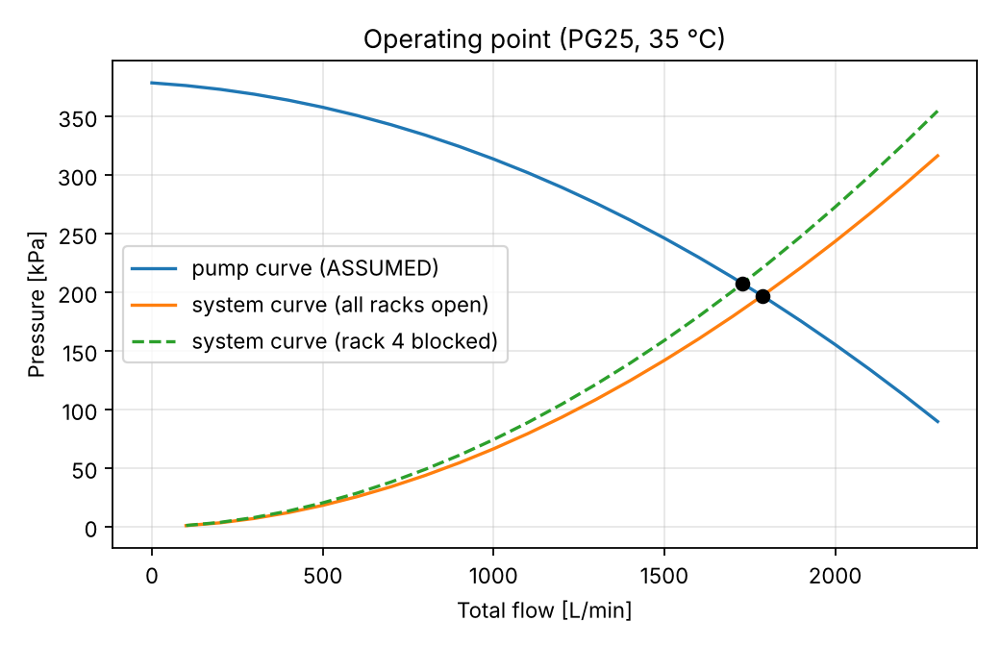
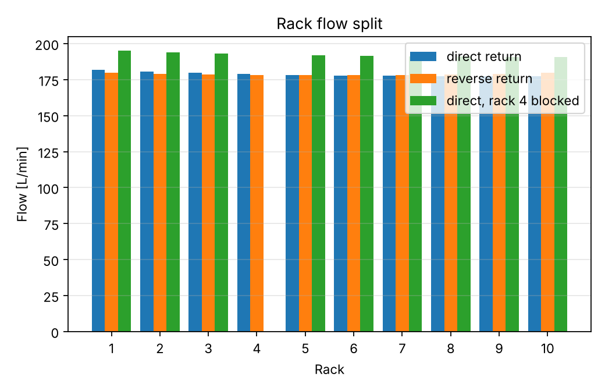

Reading: with the rack branch (~77 kPa at 150 L/min) dominating the pressure budget, the header only adds a few
kPa of imbalance, so direct return spreads flow by ~2.5 % and reverse return by ~0.9 %. Blocking one rack drops the total flow
(pump moves up its curve) while the surviving racks each gain 7.2–7.6 %.
This ordering is the model's output under these assumptions; the magnitudes depend on the assumed header diameter and rack-branch resistance.

## Thermal results (100 kW per rack, facility water 30 °C at 1800 L/min, ASSUMED CDU UA = 170 kW/K)

| Case | TCS supply [°C] | TCS return [°C] | Facility out [°C] | HX ε | CDU duty [kW] | Max chip [°C] |
|---|---|---|---|---|---|---|
| Direct return | 35.8 | 44.1 | 38.1 | 0.595 | 1010 (incl. 9.8 pump) | 79.7 |
| Reverse return | 35.8 | 44.1 | 38.1 | 0.595 | 1010 | 79.6 |
| Direct, rack 4 blocked | 35.1 | 42.9 | 37.3 | 0.609 | 910 | 77.3 (rack 4: **no flow, unprotected**) |

Rack ΔT is 8.2–8.4 K. The blocked-rack row looks better only because the blocked rack's 100 kW is no longer in the loop; that rack is
flagged as having no cooling, and the model makes no claim about how fast it overheats (that needs the transient step).

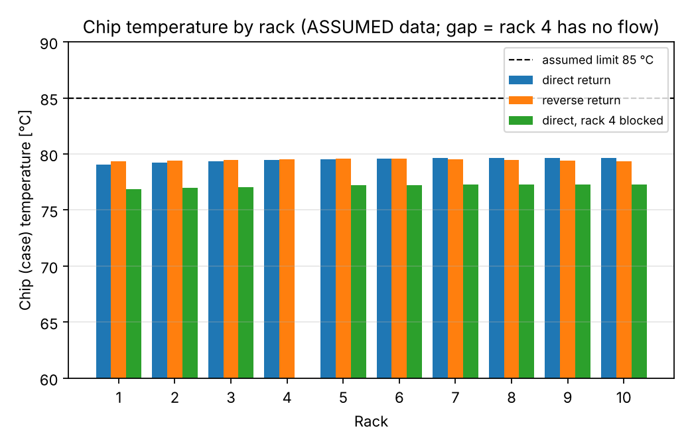

## Validation

**Hand calculation, one rack branch at 150 L/min** (`tests/test_hydraulics.py`, independent arithmetic using Swamee-Jain instead of Colebrook):

| Element | dp [Pa] |
|---|---|
| Hoses, 3 m × 38.1 mm, f = 0.0205, V = 2.19 m/s, Re = 54 900 | 3 930 |
| Hose fittings, K = 4 | 9 737 |
| Rack manifold, K = 2 | 4 868 |
| Quick-disconnect pair (20 kPa at 150 L/min, n = 2) | 20 000 |
| 36 cold plates in parallel, 4.17 L/min each (35 kPa at 4 L/min, n = 1.8) | 37 669 |
| Balancing valve, Kv = 120 | 570 |
| **Total** | **76 773** |

Package result agrees to within 0.2 %. The remaining difference is Swamee-Jain vs Colebrook in the hose friction term (~0.5 % of that term).

Thermal checks: rack ΔT against P/(ρQ·cp); loop energy balance closes (CDU duty = IT load + pump heat, same on TCS side, ε-NTU side and facility side);
ε-NTU limits (Cr→0, Cr=1, NTU→∞) and ε-NTU duty = UA·LMTD; chip temperature against hand formula; blocked-rack handling.

Other tests: Hagen-Poiseuille laminar limit, Moody smooth-pipe check, Colebrook vs Haaland, mass conservation, pump curve satisfied at operating point,
affinity laws, reverse-return symmetry, direct-return flow ordering, blocked-branch redistribution, system curve passing through the operating point.

## Validation against published data

Sources and quoted numbers are in `src/coldplate_loop/published.py`. "Calibrated" means the model was fitted to that number, so agreement proves nothing;
"check" means the model was compared with a number it was not fitted to. The calibrated configuration is `datasheet_configs()`; the pump speed is set by `control.py`.

| Item | Published | Model | Status |
|---|---|---|---|
| Vertiv XDU1350 external dp, nominal | 244 kPa at 1200 L/min (2 pumps) | 244 kPa | calibrated |
| Vertiv XDU1350 external dp, maximum | 198 kPa at 1800 L/min (3 pumps) | 198 kPa | calibrated |
| XDU1350 heat exchanger, nominal | 1368 kW at 4 K approach, 32 °C facility water | UA = 342 kW/K (balanced counterflow: approach = Q/UA) | calibrated |
| XDU1350 heat exchanger, maximum | 2912 kW at 8 K approach | implies UA = 364 kW/K, 6 % above nominal | check (assumes primary flow ≈ secondary flow, unpublished) |
| Rack dp vs flow, Lenovo GB300 NVL72 Table 27 | 5 points: 59 L/min at 2.3 psi up to 177 L/min at 18.4 psi | power law, exponent 1.90, every point within 1.4 % | calibrated |
| Lenovo table, internal consistency | required flow at 25, 30, 35, 40, 45 °C supply | all five rows imply the same return temperature, 54.6–55.0 °C, for 121.5 kW (90 % of 135 kW) in water | check: supports the approximate 90 % liquid fraction |
| XDU1350 against the Lenovo requirement | CDU data and rack data come from different documents | 10 racks need 30 % pump speed at 25 °C supply up to 87 % at 45 °C; never above 100 % | check |
| Controlled baseline, return temperature | none for GB300 | 55.2 °C | consistent with the table-implied ~55 °C |
| CDU duty vs rating | 1368 kW | 1216 kW (10 racks plus 1.0 kW pump heat) | check: below rating |
| Pump heat | max 13.7 kW electrical (2 pumps, max flow) | 1.0 kW at 41 % speed (all electrical input assumed to reach the coolant) | upper bound |
| Cold-plate chip-to-coolant R | 7.6 (Cu) to 10.4 (CuW) K/kW, 1 kW chip, ~3 L/min, TIM included (lab plates) | used as bounds | input, not a check |

Controlled baseline (10 racks, 121.5 kW liquid each, 32 °C facility water): the pump runs at 41 % speed, 819 L/min total (81.9 per rack), rack dp 29.5 kPa, TCS supply 33.0 °C, return 55.2 °C, rack ΔT 22 K, CDU duty 1216 kW.

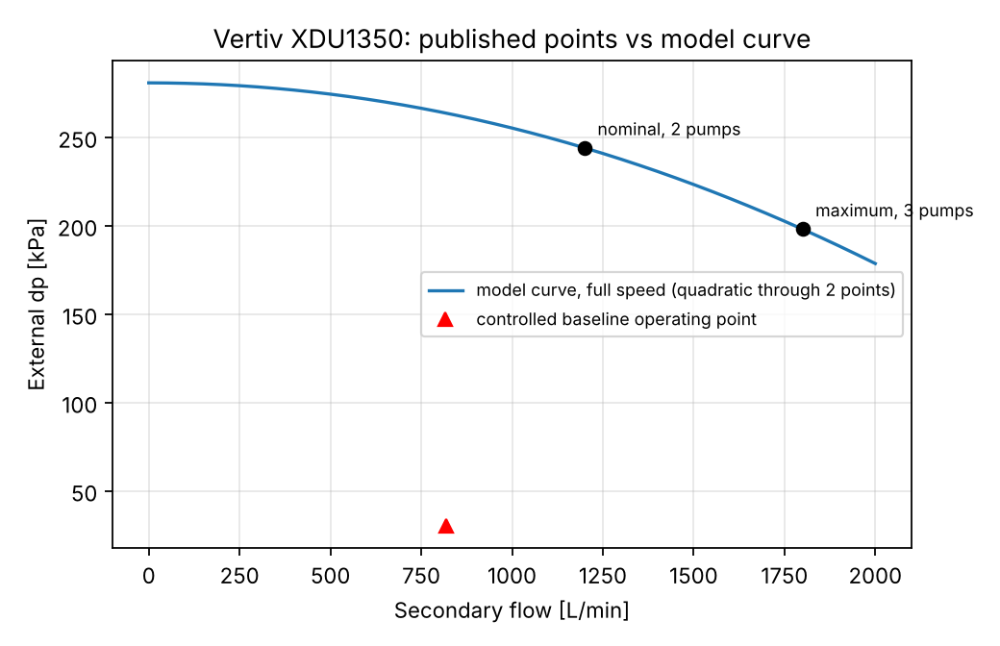
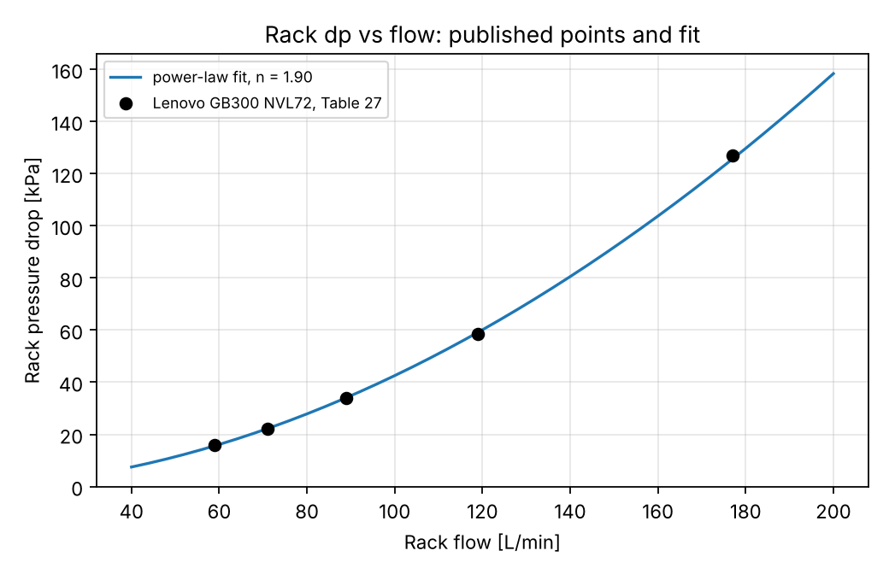

### Open gaps (what this does NOT validate)

1. **Rack figures come from one document, for the GB300.** The coolant behind Lenovo's table is not stated (water recommended, PG25 allowed); the model uses PG25 properties but applies the curve without viscosity correction.
   The "90 % to liquid" fraction is approximate. Hoses and quick disconnects between the header and the rack are not modelled, and the table does not say where its pressure drop is measured.
2. **Primary (facility) flow of the XDU1350 is not published.** 1200 L/min is assumed. It matters: the facility-temperature result moves by about 3 K with it (see Studies).
3. **Heat-exchanger UA is held constant with flow**, but the flow now ranges from about half to 1.5 times nominal. A sensitivity (UA ∝ flow^0.4) is in the Studies; the exponent is assumed.
4. **Cold plates.** R is published only near 3 L/min for one 1 kW chip class on lab plates. The model flows are 0.8 to 2.5 L/min per plate (below the 1.7–3.8 L/min tested range), the flow exponent (−0.8) and the 72 equal plates per rack are my assumptions,
   so the chip temperatures (80.8 °C with Cu, 91.1 °C with CuW at baseline) are extrapolated estimates. No chip limit is applied anywhere. The published cold-plate dp is not used (the whole-rack curve replaces it).
5. **Pump speed control.** The XDU1350 curve is one quadratic through two points at different pump counts, scaled by the affinity laws to part speed; the datasheet has no part-speed data. The control law itself (flow follows Lenovo's requirement at the current supply temperature) is my assumption of how a CDU is operated.
6. **Quick disconnects.** CPC UQD04 lists Cv ≈ 1.32 but is a small coupling with no readable dp curve and no stated fluid; not used.
7. **History.** An earlier revision of this repo had no published rack dp and, to hold 120 L/min per rack on the XDU1350 curve, carried about 216 kPa of unsourced rack resistance. The Lenovo table (about 59 kPa at 119 L/min) shows that was an artefact; it was removed.

## Cold-plate model (correlation-based, not CFD)

`coldplate.py` is a parallel-microchannel copper plate built from textbook laminar-duct correlations: Shah–London friction factor and Nusselt number for a rectangular duct (uniform-flux boundary condition), channel-wall fin efficiency, base conduction, the published TIM resistance, and assumed inlet/outlet losses (K = 1.5). The two geometric unknowns (channel width = fin thickness, channel height) are calibrated so that in water at the article's 3 L/min the plate reproduces the published 7.6 K/kW and 4.15 kPa exactly (result: 122 channels of 0.31 × 3.04 mm, Re = 275). Only that point is data; the flow dependence is what the correlations say. Entrance effects are neglected (conservative for heat transfer, optimistic for dp). This is **not CFD**: it cannot see maldistribution, pin-fin wakes or hot spots, and a conjugate-heat-transfer CFD of one channel is the right next step.

What it changed in the loop model (`datasheet_configs(plate_source="channel")`):

1. **Laminar flow means the plate-to-outlet resistance does not fall with flow.** Nu is constant in fully developed laminar flow, so h and R_conv are flow-independent (fitted exponent 0.00 over 0.5–3 L/min). My earlier R ∝ q^−0.8 was a turbulent-pipe (Dittus–Boelter) scaling and does not apply at Re ≈ 70–275. The flow dependence of chip temperature comes only through the coolant temperature rise, which the loop model already carries.
2. **The published R is inlet-referenced.** The 7.6 K/kW includes the caloric term 1/(2ṁcp) = 2.4 K/kW at 3 L/min; the loop model references chips to the rack *outlet*, so the right value there is 5.2 K/kW. The earlier configuration double-counted this.
3. **PG25 instead of water** raises R_out by 11 % (lower conductivity) and dp by 33 % (higher viscosity) at the same flow. Plate dp scales ∝ q (laminar), not q^1.8.

Effect on the baseline (10 racks, 121.5 kW, 32 °C facility water; loop temperatures unchanged, rack outlet 55.3 °C):

| Plate description | Hottest chip estimate |
|---|---|
| Published R used as outlet-referenced with q^−0.8 scaling (`plate_source="literature"`, pessimistic) | 80.8 °C (Cu) to 91.1 °C (CuW) |
| Pin-fin plate, Žukauskas crossflow correlation, calibrated to the same point, in PG25 (`plate_source="pinfin"`; h ∝ Re^0.4, resistance exponent ≈ −0.3; CuW fitted as a conductivity of 139 W/m·K) | 66.8 °C (Cu) to 72.1 °C (CuW) |
| Laminar microchannel plate calibrated to the same point, in PG25 (`plate_source="channel"`) | 65.0 °C (Cu) to 70.9 °C (CuW) |

The pin-fin description is the closest to the actual plates and lands between the other two; all three are kept and labelled.

## Studies (step 5)

Published-data loop: 10 racks, XDU1350 pump curve, Lenovo GB300 NVL72 rack curve, 121.5 kW liquid per rack, reverse return, 32 °C facility water unless varied. The pump speed holds the rack flow Lenovo requires at the current TCS supply temperature.
Limits are the sourced ones only: TCS supply ≤ 45 °C (Lenovo), pump speed ≤ 100 %, CDU duty ≤ 1368 kW (XDU1350 rating). Chip temperatures are reported as extrapolated estimates (Cu to CuW lab-plate bounds); no chip limit is applied.
Raw data in `results/study_*.csv`; `python scripts/run_studies.py` regenerates everything (a few minutes).

### 1. Liquid load sweep

| Liquid load per rack [kW] | Rack ΔT [K] | TCS return [°C] | Chip estimate, Cu to CuW plate [°C] | CDU duty [kW] | Pump speed |
|---|---|---|---|---|---|
| 40 | 7.6 | 39.8 | 48.5 to 52.0 | 401 | 40 % |
| 80 | 14.9 | 47.5 | 64.6 to 71.5 | 801 | 40 % |
| 120 | 22.0 | 55.0 | 80.3 to 90.4 | 1201 | 41 % |
| 140 | 25.4 | 58.6 | 87.9 to 99.7 | 1401 | 41 % |

The requirement is defined at full load, so at part load the flow is more than needed and the return temperature simply scales with load. The CDU rating is reached at about 136.7 kW per rack (10 racks plus 1.0 kW pump heat).

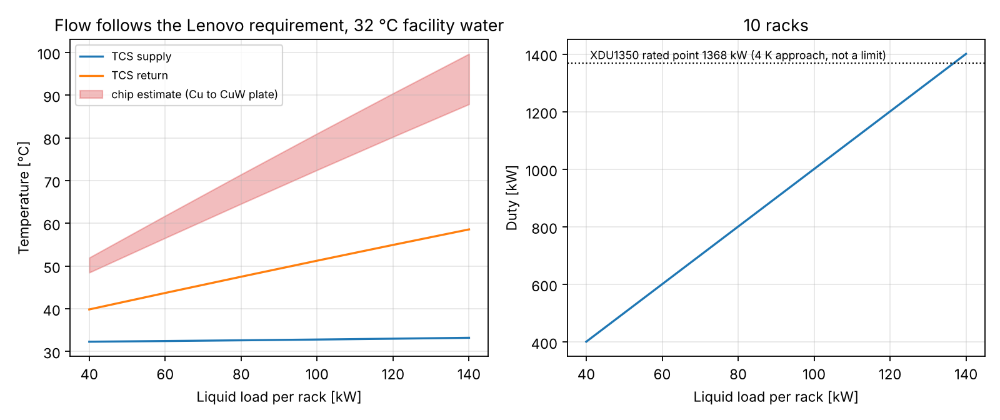

### 2. How warm can the facility water run

| Facility water [°C] | TCS supply [°C] | TCS return [°C] | Approach [K] | Pump speed | CDU duty [kW] |
|---|---|---|---|---|---|
| 20 | 20.2 | 51.0 | 0.2 | 30 % | 1215 |
| 24 | 24.2 | 55.0 | 0.2 | 30 % | 1215 |
| 28 | 28.4 | 55.5 | 0.4 | 34 % | 1216 |
| 32 | 33.0 | 55.2 | 1.0 | 41 % | 1216 |
| 36 | 38.8 | 55.1 | 2.8 | 56 % | 1218 |
| 40 | 46.2 | 56.5 | 6.2 | 87 % | 1226 |
| 44 | 50.2 | 60.5 | 6.2 | 87 % | 1226 |

With the primary flow assumed at 1200 L/min and a constant UA, the highest facility water temperature that keeps the TCS supply at or below 45 °C is **38.8 °C**; the supply limit binds in every variant and the pump never runs out of capacity below it (87 % speed at a 45 °C supply). The unpublished facility flow and the HX flow-dependence move the answer:

| Variant | Highest facility water temperature |
|---|---|
| Primary 1200 L/min, UA constant (base) | 38.8 °C |
| UA ∝ flow^0.4 (assumed exponent) | 39.2 °C |
| Primary 1800 L/min | 41.7 °C |
| Primary 1800 L/min and UA ∝ flow^0.4 | 42.2 °C |

Read it as roughly 39–42 °C, not as one number. The XDU1350 is rated at 32 °C facility water and its capacity at warmer water is not published.

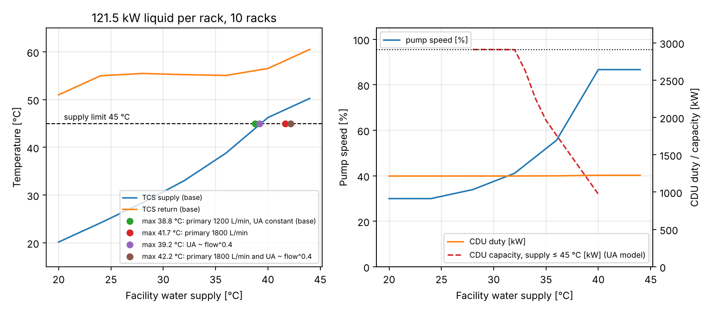

### 3. Pump limits and a blocked branch

Pump speed needed to meet the requirement, 10 racks:

| TCS supply temperature [°C] | Required rack flow [L/min] | Pump speed needed |
|---|---|---|
| 25 | 59 | 30 % |
| 30 | 71 | 36 % |
| 35 | 89 | 45 % |
| 40 | 119 | 59 % |
| 45 | 177 | 87 % |

The XDU1350 can meet Lenovo's requirement at every supply temperature in the table, with 13 % of speed in hand at 45 °C. Capping the pump (a stand-in for a degraded pump, or a failed pump in a multi-pump CDU; the datasheet gives no part-speed data) at a 36 °C facility temperature, where about 56 % speed is required:

| Pump speed cap | Total flow [L/min] | Flow shortfall vs requirement | TCS return [°C] | Rack ΔT [K] |
|---|---|---|---|---|
| 100 % | 1119 | 0.0 % | 55.1 | 16.3 |
| 60 % | 1119 | 0.0 % | 55.1 | 16.3 |
| 50 % | 1002 | 6.8 % | 56.2 | 18.2 |
| 40 % | 796 | 20.7 % | 59.7 | 22.9 |

Caps above the required speed change nothing; below it, flow falls short and the return temperature rises. The 65 °C return figure published for GB200 trays (QCT) is not reached in this range, but it is a different generation and is not used as a limit.

Rack 4 blocked with the pump speed held at 41 % (no re-control): total flow falls from 819 to 766 L/min, the nine surviving racks rise from 81.9 to 84.9–85.5 L/min (about +4 %), return 54.0 °C.
**Rack 4 itself has no flow with 121.5 kW unremoved; the model makes no claim about how fast it overheats** (that needs the transient step).

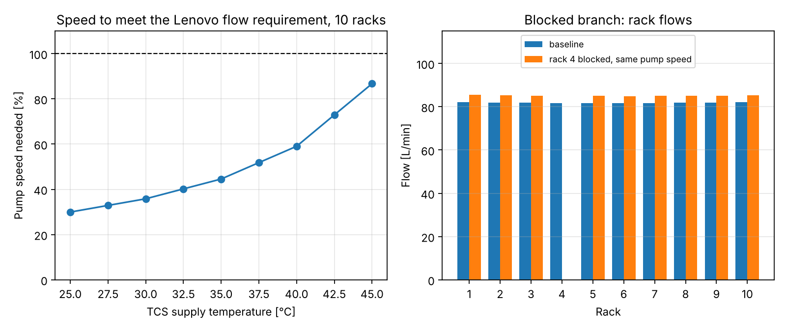

### Caveats on the studies

1. Flow follows a control law I assumed (Lenovo's requirement at the current supply temperature). A real CDU may control on pressure or return temperature instead.
2. Lenovo's requirement is for full load, so the load sweep is conservative on flow at part load.
3. Facility flow and UA flow-dependence are unpublished or assumed (table above).
4. Chip temperatures use lab-plate resistance bounds extrapolated below the tested flow range, an assumed flow exponent and 72 equal plates per rack. They are estimates, not GB300 predictions, and are not used as limits.
5. The blocked-branch case holds pump speed; a controller would speed up and raise the survivors' flow further.

## Transients (step 6a)

`transient.py` is a lumped-capacitance, time-domain version of the same loop; `scenarios.py` and `scripts/run_transient.py` run four cases. Hydraulics are quasi-steady (flows follow pump speed through a table of steady network solutions), since hydraulic time constants are seconds and thermal ones are tens of seconds to minutes.

States and equations (C = ρ·cp·V for a fluid volume):

| State | Balance |
|---|---|
| header pipe cell e (one well-mixed cell per pipe edge, 38 L each) | C_e dT_e/dt = ṁ_e cp (T_node,in − T_e) |
| coolant inside rack i (well mixed, 25 L **assumed**) | C_r dT_ro/dt = ṁ_i cp (T_in − T_ro) + (T_plate − T_ro)/R_i |
| plate + chip mass of rack i (72 × 300 J/K **assumed**) | C_p dT_plate/dt = P_i(t) − (T_plate − T_ro)/R_i |
| CDU secondary volume (200 L **assumed**, HX metal lumped in) | C_c dT_cdu/dt = ṁ cp (T_hx,out − T_cdu), T_hx,out from ε-NTU on the instantaneous inlets |
| pump speed | ds/dt = (s_target − s)/τ, τ = 10 s **assumed** |

R_i = R_cp(q_plate)/n_plates is the steady model's plate-to-coolant resistance, so the transient model has the steady model as its fixed point: started from the steady solution it drifts less than 0.02 K in 900 s (tested for all three controllers), and the ends of every scenario agree with the steady model solved at the new conditions (tested: load plateaus within 0.3 K, facility step within 0.3 K). Energy is conserved through a load step to better than 1 % of the IT energy (tested). Fluid properties are frozen at the steady mean loop temperature.

Controllers: `fixed` (speed held), `lenovo` (speed tracks the Lenovo flow requirement at the current supply temperature; the default), `return_pi` (PI on return temperature, gains **assumed and untuned**, with an optional floor at the Lenovo requirement).

| Scenario | Result (Cu plate, 10 racks, 121.5 kW each, 32 °C facility water) |
|---|---|
| **Load step 30 → 100 → 30 %**, `lenovo` control | Return rises 39.2 → 55.2 °C, 95 % settled 132 s after the step; flow barely changes (the requirement depends on supply temperature, which moves 0.7 K); hottest plate 80.9 °C, no overshoot. |
| Same, `return_pi` **without** a flow floor | At 30 % load the PI slows the pump to 23 % to hold the return setpoint; the step up then peaks the plate at 107 °C before flow catches up, and at part load the loop limit-cycles with a ~250 s period (loop transport time ≈ 90 s). With the Lenovo floor the response is identical to `lenovo`. Conclusion: return-temperature control needs a flow floor; the gains themselves are not tuned. |
| **Rack 4 blocked** at t = 60 s, pump held | Rack 4 plate heats at 4.9 K/s initially (P/C_plate would be 5.6 K/s; the rest goes into the stuck coolant): +20 K in 4.5 s, +40 K in 9 s. With a heavier plate assembly (1000 J/K) 1.5 K/s, +20 K in 14 s. Surviving racks 81.9 → 85.5 L/min. **No GPU throttling or shutdown is modelled**, so values beyond a few tens of kelvin are not physical; the result is the time scale, which is seconds, not minutes. |
| **Pump trip** at t = 60 s, 5 s coast-down | Flow below 10 % in 11.5 s; hottest plate +20 K at 9.5 s; rack coolant 85 °C after 60 s. Same caveat on throttling. The stored coolant in the headers (766 L) does not help the plates once flow stops. |
| **With GPU throttling** (`TransientConfig(throttle=True)`: power ramps to 10 % between 90 and 100 °C plate, **assumed** band, no vendor curve published) | Blocked rack: plate held at 99 °C after 30 s, 114 °C after 5 min, with the stuck coolant at 94 °C (near boiling) and 12 kW still going nowhere. Pump trip: plates 108 °C and rack coolant 87 °C after 4 min at 10 % power. Throttling buys minutes instead of seconds; it does not make a no-flow condition stable. |
| **Facility water 32 → 38 °C** step, `lenovo` control | Supply 33.0 → 43.4 °C (more than 6 K because the controller raises flow 819 → 1579 L/min to meet the requirement at the warmer supply, and the approach grows with flow at constant UA), 95 % settled in 165 s; pump 41 → 78 %; return almost unchanged (55.2 → 54.9 °C). End state matches the steady facility sweep. |

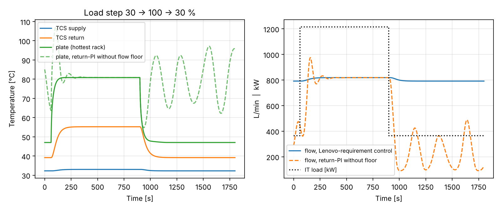
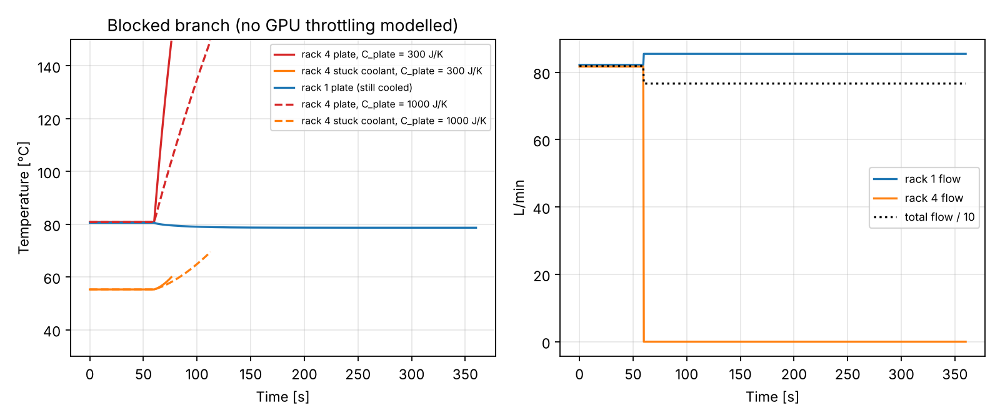
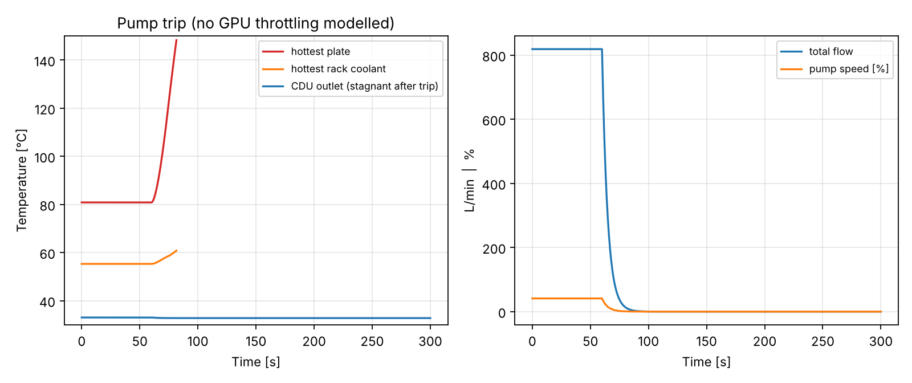
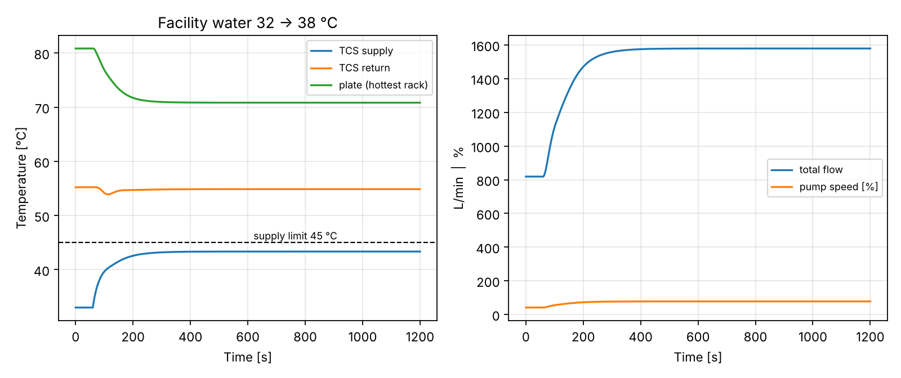

### Caveats on the transients

1. Every thermal mass is assumed (plate 300 J/K per GPU, 25 L per rack, 200 L CDU). The blocked-rack and pump-trip time scales are set by the plate mass; the 300 and 1000 J/K cases bracket what a plate assembly plausibly weighs, but nothing here is measured.
2. Plug flow in the headers is approximated by one mixed cell per pipe edge (10 per header), which smears a temperature front over a few cells (numerical dispersion). The CDU-to-last-rack transport time is about 28 s at 819 L/min.
3. GPU throttling is optional and assumed (linear power cut between 90 and 100 °C plate); without it the model heats the plates indefinitely after a blockage or trip. No boiling of stagnant coolant, no pressure effects.
4. The heat exchanger is quasi-steady with constant UA; its metal mass is lumped into the CDU volume.
5. Fluid properties are frozen at the initial mean loop temperature (the steady model re-evaluates them, hence the 0.3 K tolerances in the cross-checks).

## Reduced-order model (step 6b)

`rom.py` identifies a compact model of the loop from the transient simulator's data without using its equations (a non-intrusive ROM, the approach used for thermal digital twins and control). `scripts/run_rom.py` trains and validates it.

- **Data.** 12 open-loop runs of 40 min with random piecewise-constant inputs (load fraction 0.3–1.0, facility water 28–38 °C, commanded pump speed 30–90 %, holds 30–300 s), sampled every second: 28 905 samples. Outputs: TCS supply, TCS return, hottest plate.
- **Model.** z[k+1] = A z[k] + B u[k] + N·(s·y[k], P/s) + c, with z the last d = 5 output vectors (time-delay embedding, order 15 against 43 states in the full model), fitted by ridge least squares. The bilinear terms follow the physics: every balance contains flow × temperature, and the rack ΔT scales with P/flow. Without them (a purely linear DMD-with-control / ARX model) the return-temperature error is three times larger, whatever the order (see `results/rom_order.png`).
- **Stability.** Effective spectral radius 0.967–0.986 across the speed range (stable); the linear block alone is not the dynamics and should not be judged on its own.

| Held-out case | RMSE supply / return / hottest plate [K] | Max error [K] |
|---|---|---|
| Random inputs, new seed | 0.19 / 0.19 / 0.84 | 1.0 / 1.0 / 4.0 |
| Load step 30 → 100 → 30 % at fixed speed | 0.26 / 0.40 / 1.43 | 0.6 / 1.1 / 7.2 (at the step instant) |
| Facility 32 → 38 °C with speed 41 → 78 % | 0.34 / 0.42 / 0.80 | 0.5 / 0.6 / 1.6 |
| **Out of range:** pump commanded to 5 % | 23 / 57 / 197 | diverges |

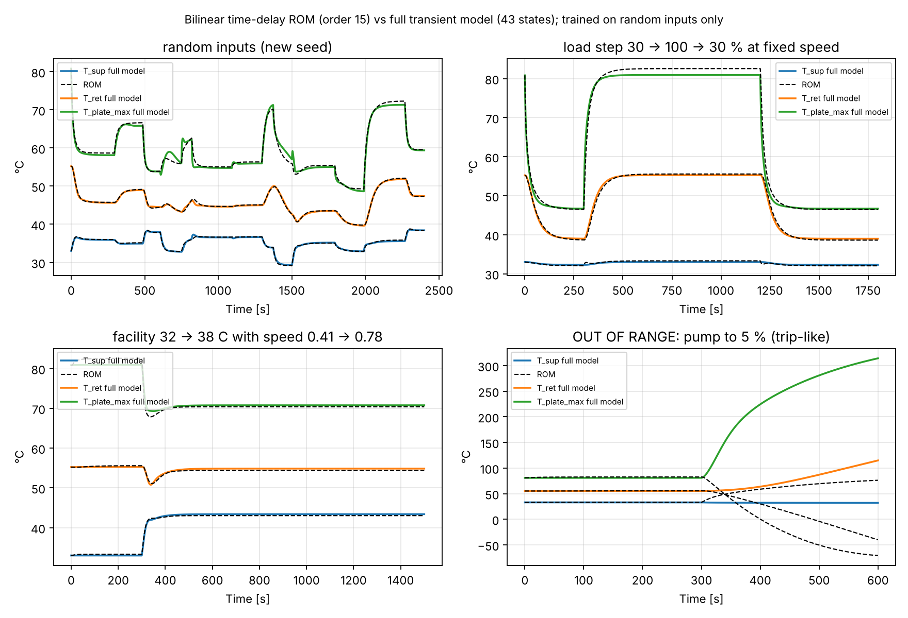

### Neural-ODE comparison

`rom_neural.py` trains a neural ODE (latent dimension 8, 4 333 parameters, tanh MLP vector field integrated at the 1 s step, encoder from the last 5 outputs; PyTorch, 80 s on CPU) on the same 12 runs; `scripts/run_rom_neural.py` compares the two on the same held-out cases.

| Held-out case | Bilinear ROM RMSE [K] | Neural ODE RMSE [K] |
|---|---|---|
| Random inputs, new seed | 0.19 / 0.19 / 0.84 | 0.10 / 0.16 / 0.47 |
| Load step at fixed speed | 0.26 / 0.40 / 1.43 | 0.13 / 0.43 / 1.36 |
| Facility step with speed change | 0.34 / 0.42 / 0.80 | 0.48 / 0.82 / 0.99 |
| Out of range: pump to 5 % | 23 / 57 / 197 | 1.2 / 9.0 / 86 |

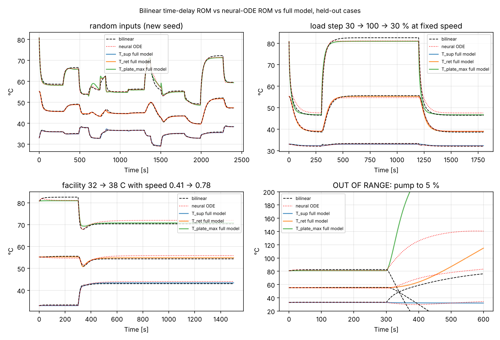

Reading: the neural ODE is more accurate on the random case and on the plate output, slightly worse on the structured facility step, and degrades more gracefully outside the training range (it still fails on the plate). The bilinear model has 69 coefficients, a known state-space form and provable stability in range; the neural one has none of that. For a control or estimation task the bilinear model is the one to start from; the neural ODE is the better pure predictor. Both inherit every assumption of the full model.

Limits, stated plainly: the ROMs are valid inside the training envelope only (the pump run-down case shows the failure and is why it is in the table); it carries a steady-state bias of about 0.3 K on supply and return and up to 1.8 K on the hottest plate at full load; the plate output, with a 5 s time constant sampled at 1 s, is the least accurate; and it inherits every assumption of the full model it was trained on. The full model is itself small (0.1 s per 10 min of simulation), so the gain is not speed but a linear state-space form that an estimator or model-predictive controller can use directly. 

### State estimation (Kalman filter on the bilinear ROM)

`estimator.py` runs a Kalman filter on the bilinear model (linear time-varying for a known pump speed) with only the supply and return temperatures measured (0.3 K noise); the hottest plate is inferred. On the plant the model was trained on it matches the open-loop model. On a mismatched plant (UA ∝ flow^0.4, 1800 L/min facility flow) the open-loop model is biased by 1.2–1.4 K; the filter brings the supply and return bias to 0.16 and 0.05 K and reduces the unmeasured plate's RMSE from 1.75 to 1.29 K. `scripts/run_estimator.py`, figure `results/estimator.png`. Noise covariances are tuning choices.

### Model-predictive control (MPC)

`mpc.py` closes the loop: every 10 s the Kalman filter updates its state from the noisy supply and return sensors, a receding-horizon problem on the bilinear ROM (200 s horizon, four speed blocks, SLSQP) picks the pump speed that holds the return at its setpoint at minimum speed subject to the 45 °C supply limit, a 30–90 % speed range and a 5 %-per-step slew limit, and the first block is applied to the full nonlinear model. `scripts/run_mpc.py`, figure `results/mpc.png`.

On a sequence of load 100 → 50 → 100 % and facility water 32 → 38 °C: return held at 54.9 °C mean (setpoint 55.2) at full load; at 50 % load the speed sits on its 30 % floor and the return falls, as it must; during the facility step the pump rises to 78 % and the supply peaks at 43.3 °C, inside the limit; slew limit respected. The filter's unmeasured plate estimate tracks the plant to 1.6 K RMSE. Weights, horizon and limits are tuning choices, and the controller assumes no forecast of load or facility temperature.

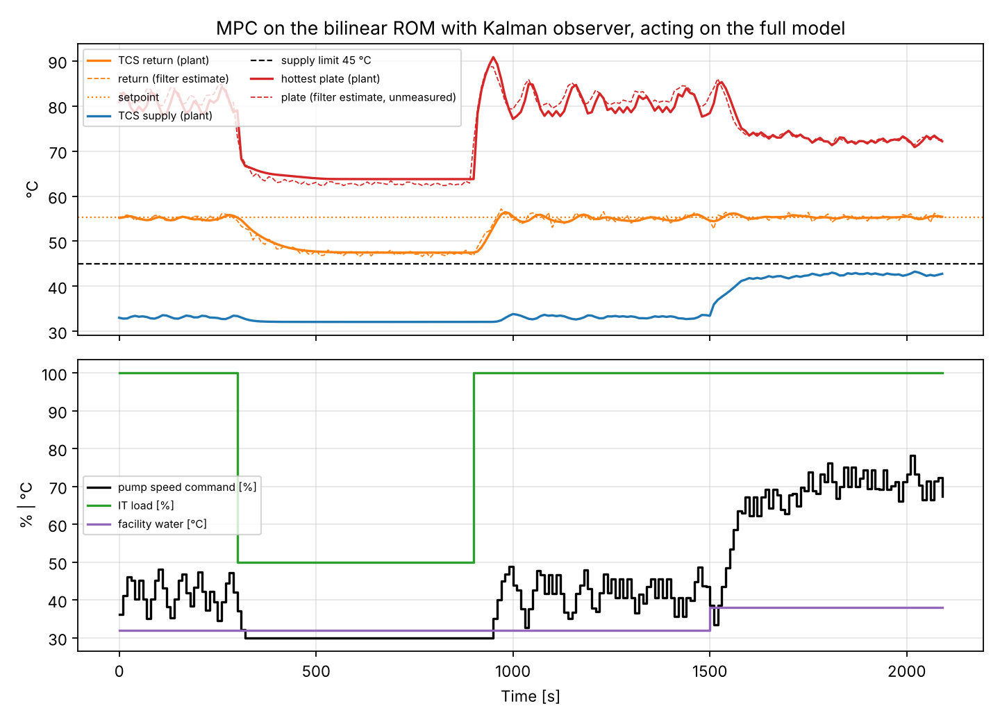

### Uncertainty of the assumed parameters

`uncertainty.py` draws the assumed parameters (facility flow 1000–1800 L/min, UA exponent 0–0.5, UA ±10 %, liquid fraction 0.85–0.95, plate exponent −0.8 to 0, plate R over the Cu–CuW bounds; uniform, ranges are judgements) and re-solves the steady model: 80 samples in `scripts/run_uncertainty.py` (~12 min).

| Output | 5 % | median | 95 % |
|---|---|---|---|
| Max facility water temperature [°C] | 37.9 | 40.8 | 42.0 |
| Hottest chip at 32 °C facility water [°C] | 66.4 | 70.8 | 80.2 |
| TCS return [°C] | 54.2 | 55.3 | 56.3 |

The facility-water limit is driven almost entirely by the unpublished facility-side flow (rank correlation 0.96); the chip estimate by the plate flow exponent (−0.80). One measurement of the CDU's facility flow would collapse the main uncertainty.

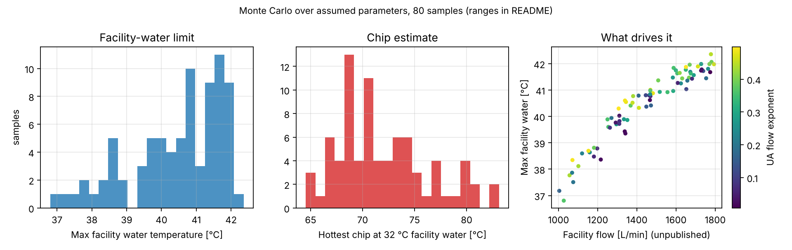

## Assumptions (hydraulic step)

1. Incompressible, steady, single-phase flow. Isothermal at one temperature (35 °C); fluid properties from CoolProp, PG25 = `INCOMP::MPG[0.25]` at 2 bar abs. Real supply/return legs differ by ~10 K, which changes viscosity by ~10 %; the thermal step will evaluate properties per leg.
2. Header ID 156.1 mm (DN150 sch10), 2 m between rack take-offs, one K = 0.5 tee loss per segment (assumed). No elevation changes.
3. Rack branch: 3 m hose ID 38.1 mm, K = 4 for fittings, K = 2 for rack manifold, QD pair 20 kPa at 150 L/min.
4. Cold plate: 35 kPa at 4 L/min per plate, exponent 1.8, 36 plates per rack in parallel with identical flow split. Dp-flow curves are used as given with no viscosity correction.
5. CDU primary-side HX 60 kPa at 1500 L/min (n = 1.85), strainer included.
6. Pump curve through (0, 380), (750, 335), (1500, 250), (2250, 100) L/min–kPa, quadratic fit. Not from a vendor.
7. Pressurisation point (expansion vessel) at pump suction, 2 bar abs.
8. Blocked branch modelled as zero flow; a stopped pump is a quadratic resistance (no check valve).
9. Thermal: CDU plate HX is counterflow with UA = 170 kW/K (assumed); facility water 30 °C, 1800 L/min; pump shaft power (hydraulic power / 0.60) heats the fluid upstream of the HX; headers and hoses are adiabatic; the 36 plates in a rack share flow and load equally; chip temperature uses the plate-outlet coolant temperature (conservative); R_cond = 0.006 K/W, R_conv,ref = 0.008 K/W at 4 L/min per plate; case limit 85 °C is a placeholder. The coolant is liquid single-phase PG25 throughout.

## Layout

```
src/coldplate_loop/   fluids.py  components.py  network.py  loop.py  thermal.py  published.py  calibration.py  control.py  studies.py  transient.py  scenarios.py  rom.py  rom_neural.py  coldplate.py  estimator.py  uncertainty.py  mpc.py
docs/                 report.md -> report.pdf (6-page technical report)
tests/                test_hydraulics.py  test_thermal.py  test_validation.py  test_studies.py  test_transient.py  test_rom.py  test_rom_neural.py  test_coldplate.py  test_estimator.py  test_uncertainty.py  test_mpc.py
scripts/              run_hydraulics.py  run_thermal.py  run_validation.py  run_studies.py  run_transient.py  run_rom.py  run_rom_neural.py  run_estimator.py  run_uncertainty.py  run_mpc.py
results/              figures
```

## Roadmap

4. Close the remaining gaps: cold-plate R and dp over the real operating flow range, rack connection hardware, XDU1350 primary flow, part-speed pump data.
6. Transients, throttling, bilinear and neural-ODE ROMs, Kalman filter, Monte Carlo, pin-fin plate: done. MPC with the filter as observer: done. Next: CFD of one pin-fin unit cell; measured loop data.
7. CFD (OpenFOAM conjugate heat transfer) of one channel / pin-fin unit cell, and of a rack manifold for flow distribution across plates.
