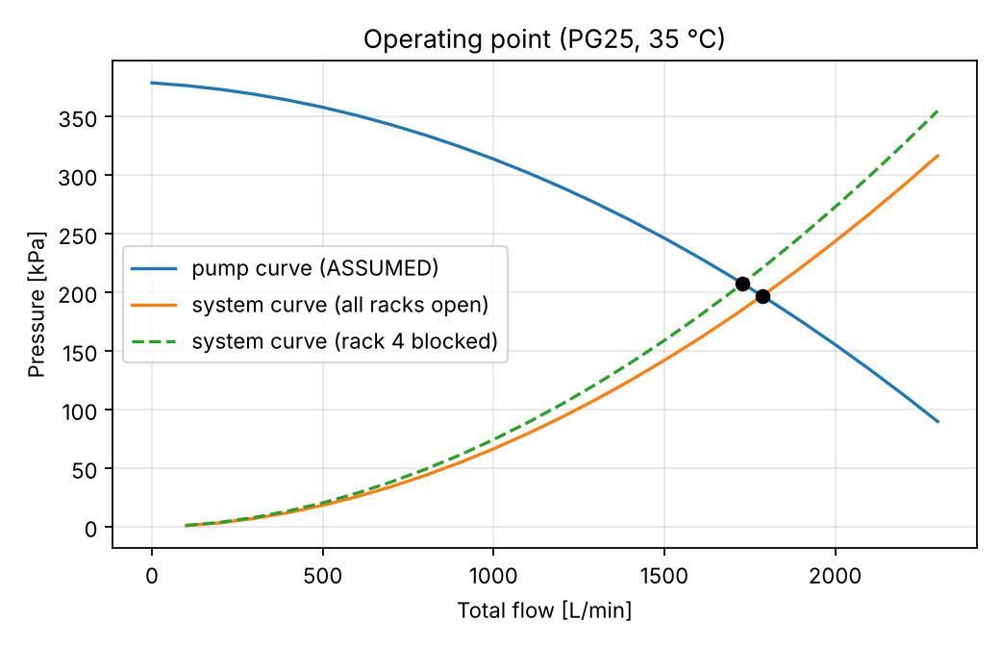
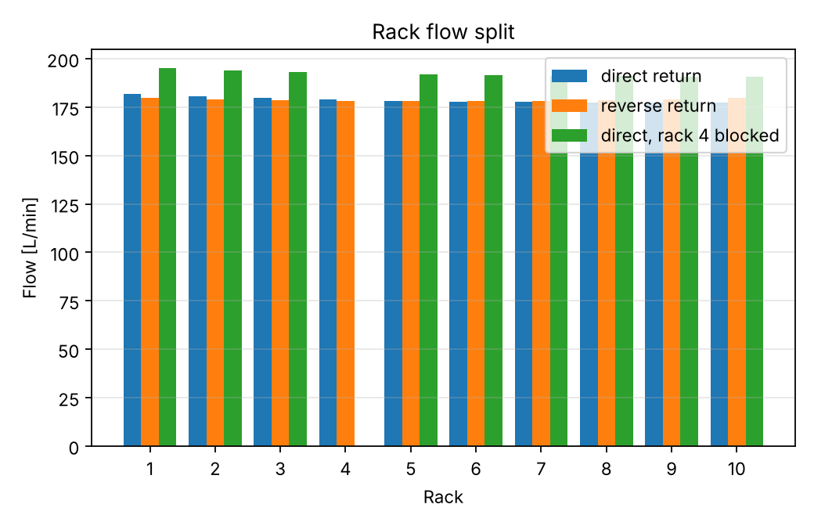
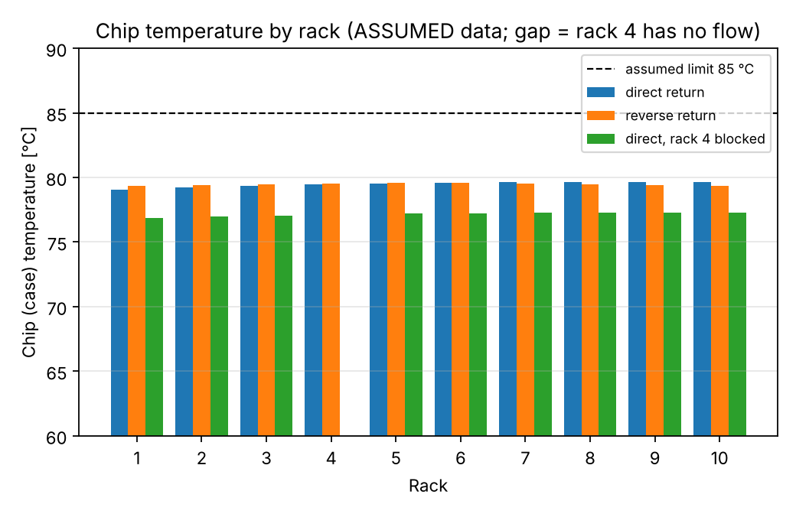
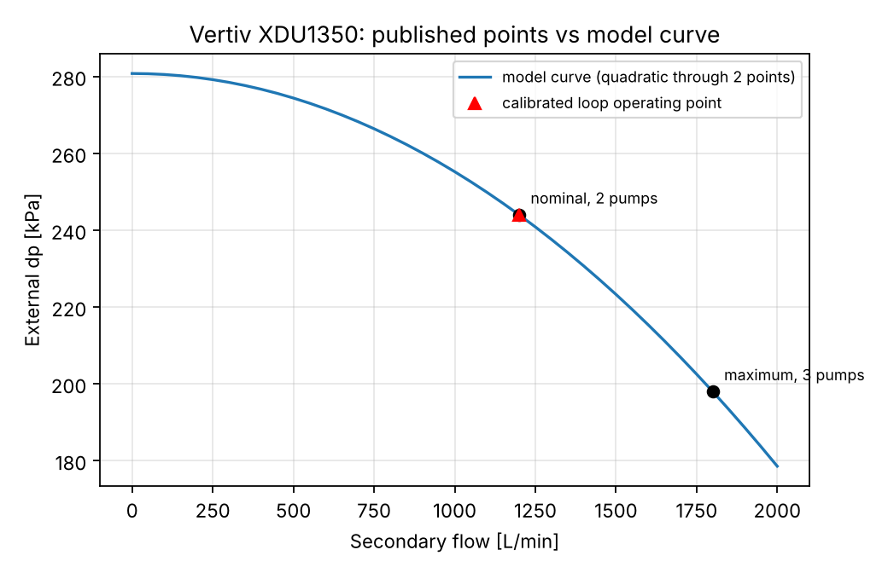

# coldplate-loop

Steady-state model of a direct-to-chip (cold-plate) liquid-cooling loop for an AI data-centre hall:
N GPU racks → manifolds → CDU (pump + liquid-to-liquid heat exchanger) → facility water.

**Status:** Steps 2 (hydraulics), 3 (steady thermal) and a first pass at 4 (comparison with published data) done. Studies and transients are next.
**Two configurations.** The default `LoopConfig` / `ThermalConfig` use ASSUMED generic component data (results below, first sections).
`datasheet_configs()` replaces the CDU, rack flow and cold-plate resistance with published data where it exists (see *Validation against published data*);
everything else stays assumed and is labelled. Nothing here is a claim about a specific product beyond the cited numbers.

## What it does now

- Pipe losses: Darcy-Weisbach with Colebrook-White friction factor (laminar 64/Re below Re 2300, linear blend to turbulent at 4000 so dp(Q) stays continuous).
- Fittings: dp = K·ρV|V|/2.
- Cold plates, quick disconnects, CDU heat exchanger: power-law dp-flow curves, dp = a·|Q|ⁿ, fitted from published points or built from one rated point plus an exponent.
- Balancing valves from Kv.
- Centrifugal pump: quadratic curve with affinity-law speed scaling.
- Network solver: nodal pressures + edge flows, solved simultaneously (mass balance at nodes, dp-flow relation on edges), with closed-branch support.
- Loop builder: direct-return or reverse-return headers, per-rack branches, blocked-branch case.
- Pump-curve ∩ system-curve operating point and rack flow split.
- Thermal (`thermal.py`): rack coolant ΔT = P/(ṁ·cp); adiabatic mixing at the return header; CDU heat exchanger by effectiveness-NTU (counterflow) with pump shaft heat added to the fluid; cold-plate resistance R = R_cond + R_conv,ref·(q/q_ref)^-0.8; chip temperature per rack; fluid properties re-evaluated at the mean loop temperature (hydraulics ⇄ thermal fixed-point iteration, converges in 2–3 passes).

## Run

```bash
pip install -e ".[dev]"
pytest                             # 36 tests: hydraulic hand-calc, thermal energy balance, published-data checks
python scripts/run_hydraulics.py   # operating points, writes results/*.png
python scripts/run_thermal.py      # temperatures and CDU duty (assumed-data case)
python scripts/run_validation.py   # datasheet-calibrated case, prints the comparison
```

## Baseline results (10 racks, PG25 at 35 °C, ASSUMED data)

| Case | Total flow [L/min] | Pump rise [kPa] | Rack flow min–max [L/min] |
|---|---|---|---|
| Direct return | 1787 | 197 | 177.3 – 181.9 |
| Reverse return | 1788 | 197 | 178.2 – 179.8 |
| Direct, rack 4 blocked | 1729 | 208 | 190.9 – 195.0 (other racks) |




Reading: with the rack branch (~77 kPa at 150 L/min) dominating the pressure budget, the header only adds a few
kPa of imbalance, so direct return spreads flow by ~2.5 % and reverse return by ~0.9 %. Blocking one rack drops the total flow
(pump moves up its curve) while the surviving racks each gain 7.2–7.6 %.
This ordering is the model's output under these assumptions; the magnitudes depend on the assumed header diameter and rack-branch resistance.

## Thermal results (100 kW per rack, facility water 30 °C at 1800 L/min, ASSUMED CDU UA = 170 kW/K)

| Case | TCS supply [°C] | TCS return [°C] | Facility out [°C] | HX ε | CDU duty [kW] | Max chip [°C] |
|---|---|---|---|---|---|---|
| Direct return | 35.8 | 44.1 | 38.1 | 0.595 | 1010 (incl. 9.8 pump) | 79.7 |
| Reverse return | 35.8 | 44.1 | 38.1 | 0.595 | 1010 | 79.6 |
| Direct, rack 4 blocked | 35.1 | 42.9 | 37.3 | 0.609 | 910 | 77.3 (rack 4: **no flow, unprotected**) |

Rack ΔT is 8.2–8.4 K. The blocked-rack row looks better only because the blocked rack's 100 kW is no longer in the loop; that rack is
flagged as having no cooling, and the model makes no claim about how fast it overheats (that needs the transient step).



## Validation

**Hand calculation, one rack branch at 150 L/min** (`tests/test_hydraulics.py`, independent arithmetic using Swamee-Jain instead of Colebrook):

| Element | dp [Pa] |
|---|---|
| Hoses, 3 m × 38.1 mm, f = 0.0205, V = 2.19 m/s, Re = 54 900 | 3 930 |
| Hose fittings, K = 4 | 9 737 |
| Rack manifold, K = 2 | 4 868 |
| Quick-disconnect pair (20 kPa at 150 L/min, n = 2) | 20 000 |
| 36 cold plates in parallel, 4.17 L/min each (35 kPa at 4 L/min, n = 1.8) | 37 669 |
| Balancing valve, Kv = 120 | 570 |
| **Total** | **76 773** |

Package result agrees to within 0.2 %. The remaining difference is Swamee-Jain vs Colebrook in the hose friction term (~0.5 % of that term).

Thermal checks: rack ΔT against P/(ρQ·cp); loop energy balance closes (CDU duty = IT load + pump heat, same on TCS side, ε-NTU side and facility side);
ε-NTU limits (Cr→0, Cr=1, NTU→∞) and ε-NTU duty = UA·LMTD; chip temperature against hand formula; blocked-rack handling.

Other tests: Hagen-Poiseuille laminar limit, Moody smooth-pipe check, Colebrook vs Haaland, mass conservation, pump curve satisfied at operating point,
affinity laws, reverse-return symmetry, direct-return flow ordering, blocked-branch redistribution, system curve passing through the operating point.

## Validation against published data

Sources and quoted numbers are in `src/coldplate_loop/published.py`. "Calibrated" means the model was fitted to that number, so agreement proves nothing;
"check" means the model was compared with a number it was not fitted to.

| Item | Published | Model | Status |
|---|---|---|---|
| Vertiv XDU1350 external dp, nominal | 244 kPa at 1200 L/min (2 pumps) | 244 kPa | calibrated |
| Vertiv XDU1350 external dp, maximum | 198 kPa at 1800 L/min (3 pumps) | 198 kPa | calibrated |
| XDU1350 HX, nominal | 1368 kW at 4 K approach (32 °C facility water) | UA = 342 kW/K (balanced counterflow: approach = Q/UA) | calibrated |
| XDU1350 HX, maximum | 2912 kW at 8 K approach | implies UA = 364 kW/K, 6 % above nominal | check (assumes primary flow ≈ secondary flow, unpublished; UA flow-dependence not modelled) |
| NVL72 rack, liquid load and flow | 115 kW, 130 L/min max (QCT QoolRack datasheet) | 115 kW at 120 L/min, ΔT 14.3 K | check: inside the envelope |
| NVL72 coolant temperatures | inlet ≤ 45 °C, return ≤ 65 °C | supply 35.1 °C, return 49.5 °C | check: inside the envelope |
| CDU duty vs capacity | 1368 kW rated | 1164 kW (10 racks + pump heat) | check: below rating |
| Pump heat | max 13.7 kW electrical (2 pumps) | 13.6 kW (assumes all electrical input ends in the coolant, an upper bound; ~1 % of duty) | consistent by construction |
| Cold plate, chip-to-coolant R | 7.6 (Cu) to 10.4 (CuW) K/kW, 1 kW chip, ~3 L/min, TIM 1.2 K/kW included (electronics-cooling.com, Apr 2026, lab plates) | used as bounds: chip 67.8–74.9 °C, 18–25 K above coolant outlet | input, not a check |

Combined result with the XDU1350 curve, 10 racks, 120 L/min per rack: CDU 1200 L/min at 244 kPa, supply 35.1 °C, return 49.5 °C, CDU duty 1164 kW.



### What this did NOT validate (open gaps)

1. **Rack-side pressure drop is not published, and the model needs far more than I itemised.** With the published CDU curve, 10 racks would draw ~250 L/min each through my assumed
   hose/QD/manifold/plate hardware (about 26 kPa at 120 L/min). Holding 120 L/min per rack requires ~242 kPa across the rack branch, so ~216 kPa is an unsourced "implied" resistance
   (carried by the balancing valve in the model, Kv ≈ 4.9 m³/h, which is not a realistic valve). Real racks probably carry this in tray plumbing, manifolds and disconnects.
   Until a real rack dp-flow figure is found, the rack flow split and all rack-side pressure results are calibration artefacts.
2. **Cold-plate dp.** The article gives 4.15 kPa for one lab plate with the flow unstated (3 L/min design flow assumed here). It plays almost no role because the implied resistance dominates.
3. **Cold-plate R vs flow.** Only the value near 3 L/min is published for one chip class; the flow exponent (−0.8, Dittus-Boelter scaling) and the use of 72 plates at 1.6 kW each
   (GPUs plus lumped CPU and other load) are my assumptions. Chip temperatures are therefore bounded estimates for a lab plate, not GB200 predictions.
4. **Quick disconnects.** CPC UQD04 lists Cv ≈ 1.32 (Kv 1.14) but it is a small coupling, the dp graph was not machine-readable, and the fluid and temperature are not stated. Not used.
5. **Primary (facility) flow** of the XDU1350 is not published, so the HX check above rests on a balanced-flow assumption.
6. The XDU1350 curve is one quadratic through two points taken at different pump counts; between and outside those points it is interpolation/extrapolation.

## Assumptions (hydraulic step)

1. Incompressible, steady, single-phase flow. Isothermal at one temperature (35 °C); fluid properties from CoolProp, PG25 = `INCOMP::MPG[0.25]` at 2 bar abs. Real supply/return legs differ by ~10 K, which changes viscosity by ~10 %; the thermal step will evaluate properties per leg.
2. Header ID 156.1 mm (DN150 sch10), 2 m between rack take-offs, one K = 0.5 tee loss per segment (assumed). No elevation changes.
3. Rack branch: 3 m hose ID 38.1 mm, K = 4 for fittings, K = 2 for rack manifold, QD pair 20 kPa at 150 L/min.
4. Cold plate: 35 kPa at 4 L/min per plate, exponent 1.8, 36 plates per rack in parallel with identical flow split. Dp-flow curves are used as given with no viscosity correction.
5. CDU primary-side HX 60 kPa at 1500 L/min (n = 1.85), strainer included.
6. Pump curve through (0, 380), (750, 335), (1500, 250), (2250, 100) L/min–kPa, quadratic fit. Not from a vendor.
7. Pressurisation point (expansion vessel) at pump suction, 2 bar abs.
8. Blocked branch modelled as zero flow; a stopped pump is a quadratic resistance (no check valve).
9. Thermal: CDU plate HX is counterflow with UA = 170 kW/K (assumed); facility water 30 °C, 1800 L/min; pump shaft power (hydraulic power / 0.60) heats the fluid upstream of the HX; headers and hoses are adiabatic; the 36 plates in a rack share flow and load equally; chip temperature uses the plate-outlet coolant temperature (conservative); R_cond = 0.006 K/W, R_conv,ref = 0.008 K/W at 4 L/min per plate; case limit 85 °C is a placeholder. The coolant is liquid single-phase PG25 throughout.

## Layout

```
src/coldplate_loop/   fluids.py  components.py  network.py  loop.py  thermal.py  published.py  calibration.py
tests/                test_hydraulics.py  test_thermal.py  test_validation.py
scripts/              run_hydraulics.py  run_thermal.py  run_validation.py
results/              figures
```

## Roadmap

4. Close the gaps above: rack-level dp-flow data (e.g. a published NVL72 or OCP rack manifold figure), cold-plate dp and R-flow curves, rack-level quick-disconnect data.
5. Studies: IT load sweep, facility water supply temperature sweep, failed pump / blocked branch with thermal consequences.
6. Transients and a reduced-order model.
7. Optional, after the first release: replace the assumed cold-plate curves with a CFD-derived (e.g. OpenFOAM conjugate heat transfer) dp-flow and R-flow fit; check manifold flow distribution across plates.
