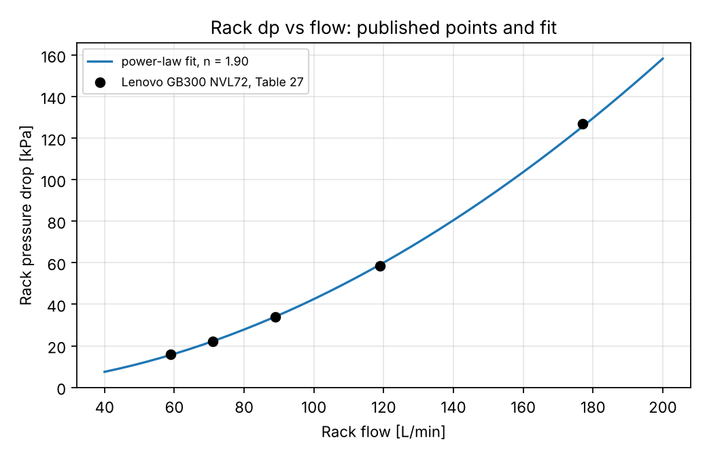
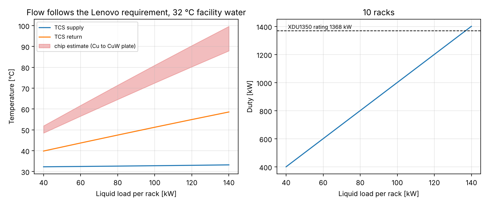
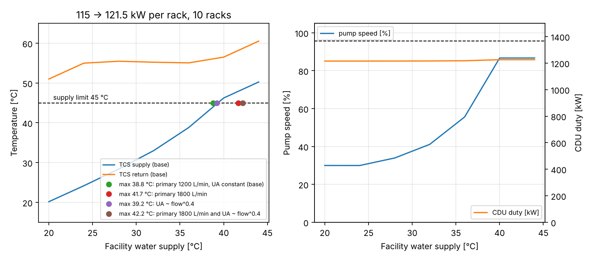
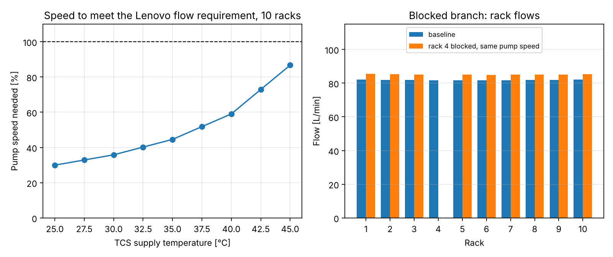

# coldplate-loop

Steady-state model of a direct-to-chip (cold-plate) liquid-cooling loop for an AI data-centre hall:
N GPU racks → manifolds → CDU (pump + liquid-to-liquid heat exchanger) → facility water.

**Status:** Steps 2 (hydraulics), 3 (steady thermal), 4 (comparison with published CDU and rack data) and 5 (studies) done. Transients and the reduced-order model are next; the open gaps are listed under *Validation against published data*.
**Two configurations.** The default `LoopConfig` / `ThermalConfig` use ASSUMED generic component data (results below, first sections).
`datasheet_configs()` replaces the CDU, the rack and the cold-plate resistance with published data where it exists (see *Validation against published data*);
everything else stays assumed and is labelled. Nothing here is a claim about a specific product beyond the cited numbers.

## What it does now

- Pipe losses: Darcy-Weisbach with Colebrook-White friction factor (laminar 64/Re below Re 2300, linear blend to turbulent at 4000 so dp(Q) stays continuous).
- Fittings: dp = K·ρV|V|/2.
- Cold plates, quick disconnects, CDU heat exchanger: power-law dp-flow curves, dp = a·|Q|ⁿ, fitted from published points or built from one rated point plus an exponent.
- Balancing valves from Kv.
- Centrifugal pump: quadratic curve with affinity-law speed scaling.
- Network solver: nodal pressures + edge flows, solved simultaneously (mass balance at nodes, dp-flow relation on edges), with closed-branch support.
- Loop builder: direct-return or reverse-return headers, per-rack branches, blocked-branch case.
- Pump-curve ∩ system-curve operating point and rack flow split.
- Thermal (`thermal.py`): rack coolant ΔT = P/(ṁ·cp); adiabatic mixing at the return header; CDU heat exchanger by effectiveness-NTU (counterflow) with pump shaft heat added to the fluid; cold-plate resistance R = R_cond + R_conv,ref·(q/q_ref)^-0.8; chip temperature per rack; fluid properties re-evaluated at the mean loop temperature (hydraulics ⇄ thermal fixed-point iteration, converges in 2–3 passes).

## Run

```bash
pip install -e ".[dev]"
pytest                             # 43 tests: hydraulic hand-calc, thermal energy balance, published-data checks, studies (~1 min)
python scripts/run_hydraulics.py   # operating points, writes results/*.png
python scripts/run_thermal.py      # temperatures and CDU duty (assumed-data case)
python scripts/run_validation.py   # datasheet-calibrated case, prints the comparison
python scripts/run_studies.py      # load, facility water temperature, pump and branch failure studies
```

## Baseline results (10 racks, PG25 at 35 °C, ASSUMED data)

| Case | Total flow [L/min] | Pump rise [kPa] | Rack flow min–max [L/min] |
|---|---|---|---|
| Direct return | 1787 | 197 | 177.3 – 181.9 |
| Reverse return | 1788 | 197 | 178.2 – 179.8 |
| Direct, rack 4 blocked | 1729 | 208 | 190.9 – 195.0 (other racks) |


Reading: with the rack branch (~77 kPa at 150 L/min) dominating the pressure budget, the header only adds a few
kPa of imbalance, so direct return spreads flow by ~2.5 % and reverse return by ~0.9 %. Blocking one rack drops the total flow
(pump moves up its curve) while the surviving racks each gain 7.2–7.6 %.
This ordering is the model's output under these assumptions; the magnitudes depend on the assumed header diameter and rack-branch resistance.

## Thermal results (100 kW per rack, facility water 30 °C at 1800 L/min, ASSUMED CDU UA = 170 kW/K)

| Case | TCS supply [°C] | TCS return [°C] | Facility out [°C] | HX ε | CDU duty [kW] | Max chip [°C] |
|---|---|---|---|---|---|---|
| Direct return | 35.8 | 44.1 | 38.1 | 0.595 | 1010 (incl. 9.8 pump) | 79.7 |
| Reverse return | 35.8 | 44.1 | 38.1 | 0.595 | 1010 | 79.6 |
| Direct, rack 4 blocked | 35.1 | 42.9 | 37.3 | 0.609 | 910 | 77.3 (rack 4: **no flow, unprotected**) |

Rack ΔT is 8.2–8.4 K. The blocked-rack row looks better only because the blocked rack's 100 kW is no longer in the loop; that rack is
flagged as having no cooling, and the model makes no claim about how fast it overheats (that needs the transient step).


## Validation

**Hand calculation, one rack branch at 150 L/min** (`tests/test_hydraulics.py`, independent arithmetic using Swamee-Jain instead of Colebrook):

| Element | dp [Pa] |
|---|---|
| Hoses, 3 m × 38.1 mm, f = 0.0205, V = 2.19 m/s, Re = 54 900 | 3 930 |
| Hose fittings, K = 4 | 9 737 |
| Rack manifold, K = 2 | 4 868 |
| Quick-disconnect pair (20 kPa at 150 L/min, n = 2) | 20 000 |
| 36 cold plates in parallel, 4.17 L/min each (35 kPa at 4 L/min, n = 1.8) | 37 669 |
| Balancing valve, Kv = 120 | 570 |
| **Total** | **76 773** |

Package result agrees to within 0.2 %. The remaining difference is Swamee-Jain vs Colebrook in the hose friction term (~0.5 % of that term).

Thermal checks: rack ΔT against P/(ρQ·cp); loop energy balance closes (CDU duty = IT load + pump heat, same on TCS side, ε-NTU side and facility side);
ε-NTU limits (Cr→0, Cr=1, NTU→∞) and ε-NTU duty = UA·LMTD; chip temperature against hand formula; blocked-rack handling.

Other tests: Hagen-Poiseuille laminar limit, Moody smooth-pipe check, Colebrook vs Haaland, mass conservation, pump curve satisfied at operating point,
affinity laws, reverse-return symmetry, direct-return flow ordering, blocked-branch redistribution, system curve passing through the operating point.

## Validation against published data

Sources and quoted numbers are in `src/coldplate_loop/published.py`. "Calibrated" means the model was fitted to that number, so agreement proves nothing;
"check" means the model was compared with a number it was not fitted to. The calibrated configuration is `datasheet_configs()`; the pump speed is set by `control.py`.

| Item | Published | Model | Status |
|---|---|---|---|
| Vertiv XDU1350 external dp, nominal | 244 kPa at 1200 L/min (2 pumps) | 244 kPa | calibrated |
| Vertiv XDU1350 external dp, maximum | 198 kPa at 1800 L/min (3 pumps) | 198 kPa | calibrated |
| XDU1350 heat exchanger, nominal | 1368 kW at 4 K approach, 32 °C facility water | UA = 342 kW/K (balanced counterflow: approach = Q/UA) | calibrated |
| XDU1350 heat exchanger, maximum | 2912 kW at 8 K approach | implies UA = 364 kW/K, 6 % above nominal | check (assumes primary flow ≈ secondary flow, unpublished) |
| Rack dp vs flow, Lenovo GB300 NVL72 Table 27 | 5 points: 59 L/min at 2.3 psi up to 177 L/min at 18.4 psi | power law, exponent 1.90, every point within 1.4 % | calibrated |
| Lenovo table, internal consistency | required flow at 25, 30, 35, 40, 45 °C supply | all five rows imply the same return temperature, 54.6–55.0 °C, for 121.5 kW (90 % of 135 kW) in water | check: supports the approximate 90 % liquid fraction |
| XDU1350 against the Lenovo requirement | CDU data and rack data come from different documents | 10 racks need 30 % pump speed at 25 °C supply up to 87 % at 45 °C; never above 100 % | check |
| Controlled baseline, return temperature | none for GB300 | 55.2 °C | consistent with the table-implied ~55 °C |
| CDU duty vs rating | 1368 kW | 1216 kW (10 racks plus 1.0 kW pump heat) | check: below rating |
| Pump heat | max 13.7 kW electrical (2 pumps, max flow) | 1.0 kW at 41 % speed (all electrical input assumed to reach the coolant) | upper bound |
| Cold-plate chip-to-coolant R | 7.6 (Cu) to 10.4 (CuW) K/kW, 1 kW chip, ~3 L/min, TIM included (lab plates) | used as bounds | input, not a check |

Controlled baseline (10 racks, 121.5 kW liquid each, 32 °C facility water): the pump runs at 41 % speed, 819 L/min total (81.9 per rack), rack dp 29.5 kPa, TCS supply 33.0 °C, return 55.2 °C, rack ΔT 22 K, CDU duty 1216 kW.




### Open gaps (what this does NOT validate)

1. **Rack figures come from one document, for the GB300.** The coolant behind Lenovo's table is not stated (water recommended, PG25 allowed); the model uses PG25 properties but applies the curve without viscosity correction.
   The "90 % to liquid" fraction is approximate. Hoses and quick disconnects between the header and the rack are not modelled, and the table does not say where its pressure drop is measured.
2. **Primary (facility) flow of the XDU1350 is not published.** 1200 L/min is assumed. It matters: the facility-temperature result moves by about 3 K with it (see Studies).
3. **Heat-exchanger UA is held constant with flow**, but the flow now ranges from about half to 1.5 times nominal. A sensitivity (UA ∝ flow^0.4) is in the Studies; the exponent is assumed.
4. **Cold plates.** R is published only near 3 L/min for one 1 kW chip class on lab plates. The model flows are 0.8 to 2.5 L/min per plate (below the 1.7–3.8 L/min tested range), the flow exponent (−0.8) and the 72 equal plates per rack are my assumptions,
   so the chip temperatures (80.8 °C with Cu, 91.1 °C with CuW at baseline) are extrapolated estimates. No chip limit is applied anywhere. The published cold-plate dp is not used (the whole-rack curve replaces it).
5. **Pump speed control.** The XDU1350 curve is one quadratic through two points at different pump counts, scaled by the affinity laws to part speed; the datasheet has no part-speed data. The control law itself (flow follows Lenovo's requirement at the current supply temperature) is my assumption of how a CDU is operated.
6. **Quick disconnects.** CPC UQD04 lists Cv ≈ 1.32 but is a small coupling with no readable dp curve and no stated fluid; not used.
7. **History.** An earlier revision of this repo had no published rack dp and, to hold 120 L/min per rack on the XDU1350 curve, carried about 216 kPa of unsourced rack resistance. The Lenovo table (about 59 kPa at 119 L/min) shows that was an artefact; it was removed.

## Studies (step 5)

Published-data loop: 10 racks, XDU1350 pump curve, Lenovo GB300 NVL72 rack curve, 121.5 kW liquid per rack, reverse return, 32 °C facility water unless varied. The pump speed holds the rack flow Lenovo requires at the current TCS supply temperature.
Limits are the sourced ones only: TCS supply ≤ 45 °C (Lenovo), pump speed ≤ 100 %, CDU duty ≤ 1368 kW (XDU1350 rating). Chip temperatures are reported as extrapolated estimates (Cu to CuW lab-plate bounds); no chip limit is applied.
Raw data in `results/study_*.csv`; `python scripts/run_studies.py` regenerates everything (a few minutes).

### 1. Liquid load sweep

| Liquid load per rack [kW] | Rack ΔT [K] | TCS return [°C] | Chip estimate, Cu to CuW plate [°C] | CDU duty [kW] | Pump speed |
|---|---|---|---|---|---|
| 40 | 7.6 | 39.8 | 48.5 to 52.0 | 401 | 40 % |
| 80 | 14.9 | 47.5 | 64.6 to 71.5 | 801 | 40 % |
| 120 | 22.0 | 55.0 | 80.3 to 90.4 | 1201 | 41 % |
| 140 | 25.4 | 58.6 | 87.9 to 99.7 | 1401 | 41 % |

The requirement is defined at full load, so at part load the flow is more than needed and the return temperature simply scales with load. The CDU rating is reached at about 136.7 kW per rack (10 racks plus 1.0 kW pump heat).



### 2. How warm can the facility water run

| Facility water [°C] | TCS supply [°C] | TCS return [°C] | Approach [K] | Pump speed | CDU duty [kW] |
|---|---|---|---|---|---|
| 20 | 20.2 | 51.0 | 0.2 | 30 % | 1215 |
| 24 | 24.2 | 55.0 | 0.2 | 30 % | 1215 |
| 28 | 28.4 | 55.5 | 0.4 | 34 % | 1216 |
| 32 | 33.0 | 55.2 | 1.0 | 41 % | 1216 |
| 36 | 38.8 | 55.1 | 2.8 | 56 % | 1218 |
| 40 | 46.2 | 56.5 | 6.2 | 87 % | 1226 |
| 44 | 50.2 | 60.5 | 6.2 | 87 % | 1226 |

With the primary flow assumed at 1200 L/min and a constant UA, the highest facility water temperature that keeps the TCS supply at or below 45 °C is **38.8 °C**; the supply limit binds in every variant and the pump never runs out of capacity below it (87 % speed at a 45 °C supply). The unpublished facility flow and the HX flow-dependence move the answer:

| Variant | Highest facility water temperature |
|---|---|
| Primary 1200 L/min, UA constant (base) | 38.8 °C |
| UA ∝ flow^0.4 (assumed exponent) | 39.2 °C |
| Primary 1800 L/min | 41.7 °C |
| Primary 1800 L/min and UA ∝ flow^0.4 | 42.2 °C |

Read it as roughly 39–42 °C, not as one number. The XDU1350 is rated at 32 °C facility water and its capacity at warmer water is not published.



### 3. Pump limits and a blocked branch

Pump speed needed to meet the requirement, 10 racks:

| TCS supply temperature [°C] | Required rack flow [L/min] | Pump speed needed |
|---|---|---|
| 25 | 59 | 30 % |
| 30 | 71 | 36 % |
| 35 | 89 | 45 % |
| 40 | 119 | 59 % |
| 45 | 177 | 87 % |

The XDU1350 can meet Lenovo's requirement at every supply temperature in the table, with 13 % of speed in hand at 45 °C. Capping the pump (a stand-in for a degraded pump, or a failed pump in a multi-pump CDU; the datasheet gives no part-speed data) at a 36 °C facility temperature, where about 56 % speed is required:

| Pump speed cap | Total flow [L/min] | Flow shortfall vs requirement | TCS return [°C] | Rack ΔT [K] |
|---|---|---|---|---|
| 100 % | 1119 | 0.0 % | 55.1 | 16.3 |
| 60 % | 1119 | 0.0 % | 55.1 | 16.3 |
| 50 % | 1002 | 6.8 % | 56.2 | 18.2 |
| 40 % | 796 | 20.7 % | 59.7 | 22.9 |

Caps above the required speed change nothing; below it, flow falls short and the return temperature rises. The 65 °C return figure published for GB200 trays (QCT) is not reached in this range, but it is a different generation and is not used as a limit.

Rack 4 blocked with the pump speed held at 41 % (no re-control): total flow falls from 819 to 766 L/min, the nine surviving racks rise from 81.9 to 84.9–85.5 L/min (about +4 %), return 54.0 °C.
**Rack 4 itself has no flow with 121.5 kW unremoved; the model makes no claim about how fast it overheats** (that needs the transient step).



### Caveats on the studies

1. Flow follows a control law I assumed (Lenovo's requirement at the current supply temperature). A real CDU may control on pressure or return temperature instead.
2. Lenovo's requirement is for full load, so the load sweep is conservative on flow at part load.
3. Facility flow and UA flow-dependence are unpublished or assumed (table above).
4. Chip temperatures use lab-plate resistance bounds extrapolated below the tested flow range, an assumed flow exponent and 72 equal plates per rack. They are estimates, not GB300 predictions, and are not used as limits.
5. The blocked-branch case holds pump speed; a controller would speed up and raise the survivors' flow further.

## Assumptions (hydraulic step)

1. Incompressible, steady, single-phase flow. Isothermal at one temperature (35 °C); fluid properties from CoolProp, PG25 = `INCOMP::MPG[0.25]` at 2 bar abs. Real supply/return legs differ by ~10 K, which changes viscosity by ~10 %; the thermal step will evaluate properties per leg.
2. Header ID 156.1 mm (DN150 sch10), 2 m between rack take-offs, one K = 0.5 tee loss per segment (assumed). No elevation changes.
3. Rack branch: 3 m hose ID 38.1 mm, K = 4 for fittings, K = 2 for rack manifold, QD pair 20 kPa at 150 L/min.
4. Cold plate: 35 kPa at 4 L/min per plate, exponent 1.8, 36 plates per rack in parallel with identical flow split. Dp-flow curves are used as given with no viscosity correction.
5. CDU primary-side HX 60 kPa at 1500 L/min (n = 1.85), strainer included.
6. Pump curve through (0, 380), (750, 335), (1500, 250), (2250, 100) L/min–kPa, quadratic fit. Not from a vendor.
7. Pressurisation point (expansion vessel) at pump suction, 2 bar abs.
8. Blocked branch modelled as zero flow; a stopped pump is a quadratic resistance (no check valve).
9. Thermal: CDU plate HX is counterflow with UA = 170 kW/K (assumed); facility water 30 °C, 1800 L/min; pump shaft power (hydraulic power / 0.60) heats the fluid upstream of the HX; headers and hoses are adiabatic; the 36 plates in a rack share flow and load equally; chip temperature uses the plate-outlet coolant temperature (conservative); R_cond = 0.006 K/W, R_conv,ref = 0.008 K/W at 4 L/min per plate; case limit 85 °C is a placeholder. The coolant is liquid single-phase PG25 throughout.

## Layout

```
src/coldplate_loop/   fluids.py  components.py  network.py  loop.py  thermal.py  published.py  calibration.py  control.py  studies.py
tests/                test_hydraulics.py  test_thermal.py  test_validation.py  test_studies.py
scripts/              run_hydraulics.py  run_thermal.py  run_validation.py  run_studies.py
results/              figures
```

## Roadmap

4. Close the remaining gaps: cold-plate R and dp over the real operating flow range, rack connection hardware, XDU1350 primary flow, part-speed pump data.
6. Transients and a reduced-order model.
7. Optional, after the first release: replace the assumed cold-plate curves with a CFD-derived (e.g. OpenFOAM conjugate heat transfer) dp-flow and R-flow fit; check manifold flow distribution across plates.
