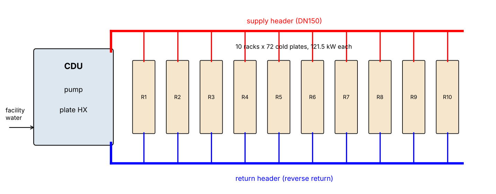
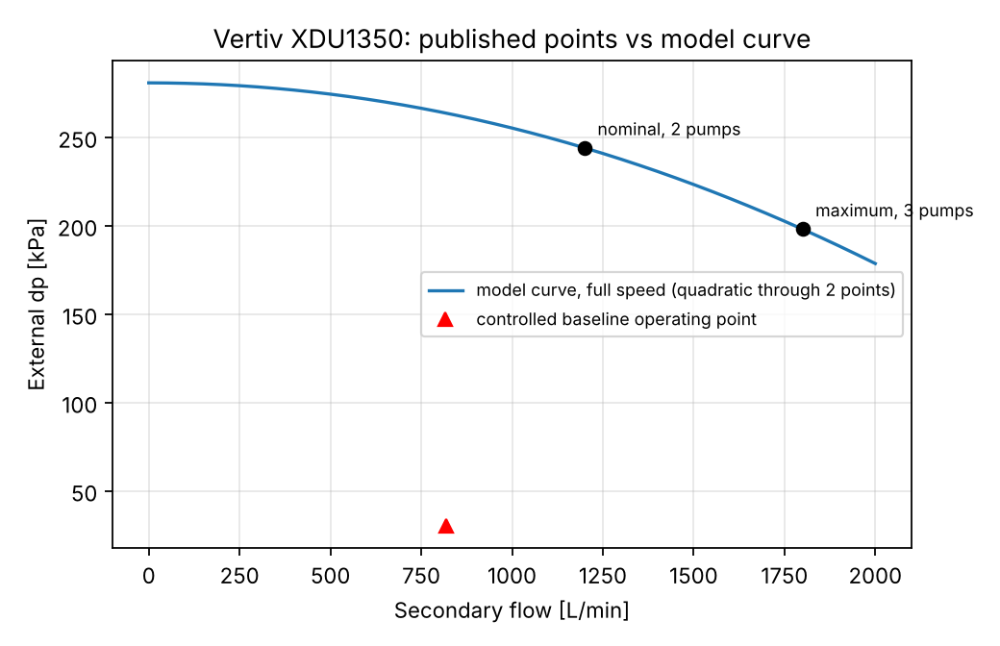
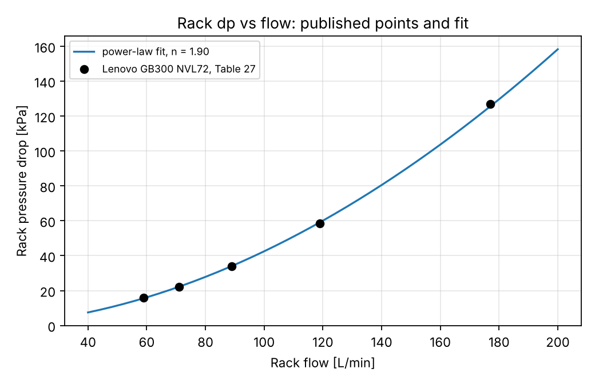
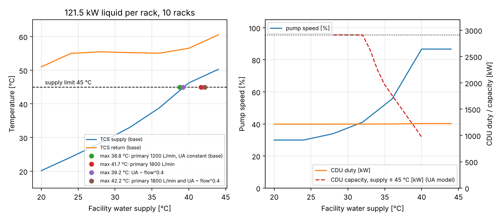
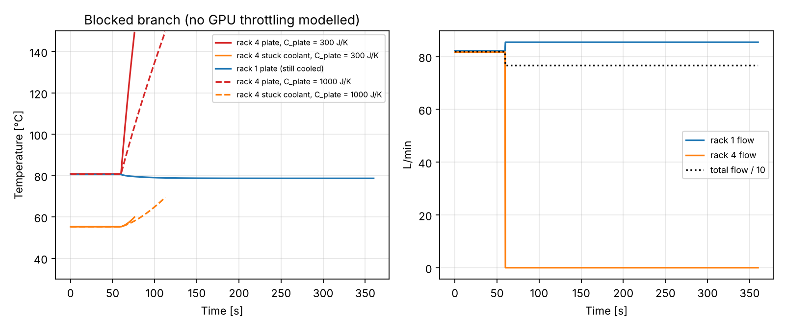
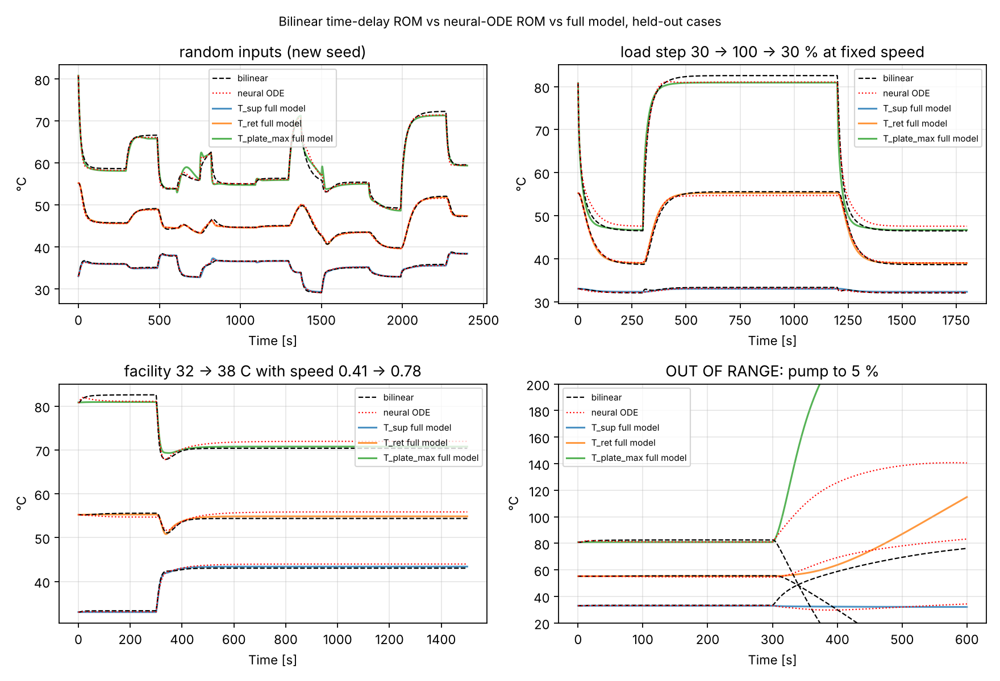
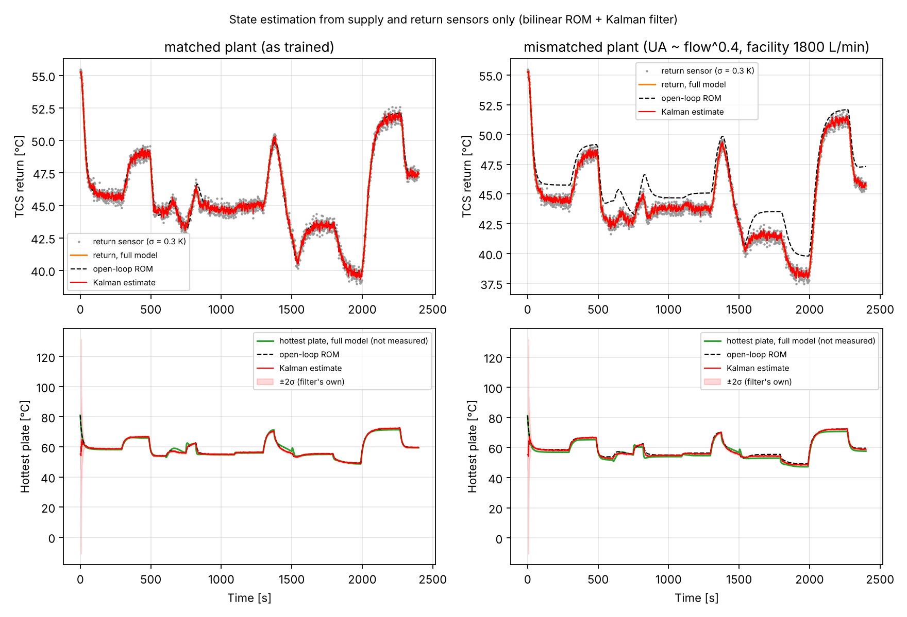
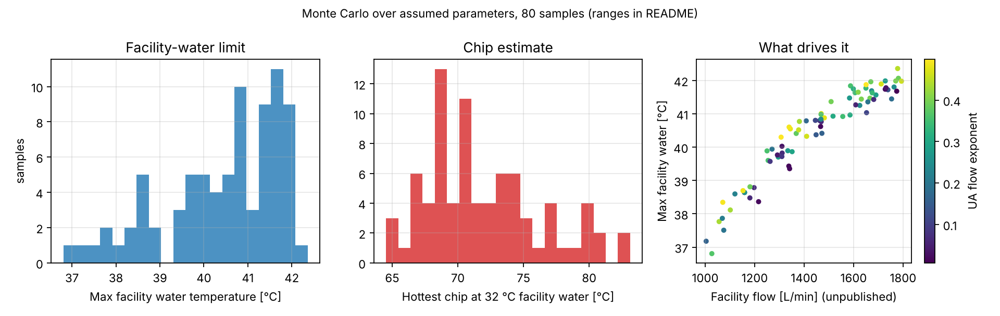

## Summary

A Python model of a direct-to-chip liquid-cooling loop (10 GPU racks, headers, coolant distribution unit) was built from pipe-network hydraulics and energy balances, calibrated to published Vertiv XDU1350 and Lenovo GB300 NVL72 data, extended to the time domain, and used to identify two reduced-order models. The repository is public at github.com/arenchichmanian/coldplate-loop with 68 automated tests.

With 10 racks at 121.5 kW liquid load and 32 °C facility water, the CDU pump runs at 41 % speed (819 L/min) for a 33.0 °C supply and 55.2 °C return; the return agrees with the value implied independently by Lenovo's flow table. The facility water can be warmed to about 39 °C before the 45 °C rack supply limit is reached, with a 39–42 °C spread across two unpublished parameters. A blocked rack branch heats its cold plates at about 5 K/s, so protection must act in seconds; GPU throttling buys minutes but does not stabilise a no-flow condition. A bilinear time-delay reduced-order model of order 15, and a neural ODE, predict supply, return and hottest-plate temperatures to 0.1–0.8 K RMSE on held-out cases; a Kalman filter on the bilinear model removes the model's bias when the plant differs from the training model, using only supply and return sensors.

Every number in this report is marked as calibrated (fitted to a published value), checked (compared with a value not fitted to), or assumed. The model is not a validated twin of any installation: no measured loop data exist in the public domain, and chip temperatures are estimates with a stated band.

## 1. System and scope

{ width=85% }

The loop modelled is the Technology Cooling System of an AI hall: N rack branches in parallel between a supply and a return header, fed by a CDU whose pump and plate heat exchanger separate it from the facility water (warm water from dry coolers or chillers, treated as a boundary condition). The brief called for hydraulics, steady thermal balances, comparison with published data, parametric studies, transients and a reduced-order model; all six are in the repository. The model is one-dimensional (system level) throughout; no CFD was run.

## 2. Methods

**Hydraulics.** Each element gives a pressure drop as a function of volumetric flow: pipes by Darcy–Weisbach with the Colebrook–White friction factor (laminar below Re 2300, blended to turbulent at 4000); fittings by K-factors; cold plates, quick disconnects and the whole rack by power laws Δp = a·Qⁿ; balancing valves by Kv; the pump by a quadratic curve with affinity-law speed scaling. The network is solved for nodal pressures and edge flows simultaneously (mass balance at every node, pressure–flow relation on every edge), which also handles closed branches. One rack branch was checked by hand: 76.77 kPa at 150 L/min against the code's value within 0.2 %.

**Steady thermal.** Rack coolant rise ΔT = P/(ṁ·cp); adiabatic mixing in the return header; pump shaft heat added upstream of the exchanger; the CDU exchanger by effectiveness–NTU for counterflow; chip temperature as rack outlet plus power times a plate resistance. Fluid properties (CoolProp, 25 % propylene glycol) are re-evaluated at the mean loop temperature, iterating hydraulics and thermal to a fixed point. The energy balance closes identically on the TCS side, the exchanger and the facility side (tested).

**Control.** The pump speed holds the rack flow that Lenovo requires at the current supply temperature (its table runs from 59 L/min at 25 °C to 177 L/min at 45 °C). A PI controller on return temperature is included for comparison.

**Transient.** Lumped-capacitance balances on the same topology: one well-mixed cell per header pipe edge (38 L each from the geometry), the coolant inside each rack (25 L, assumed), the plate-plus-chip mass of each rack (72 × 300 J/K, assumed), the CDU secondary volume (200 L, assumed) and a first-order pump lag (10 s, assumed). Flows are quasi-steady, looked up from steady network solutions as a function of pump speed. The steady model is the fixed point of the transient one (drift below 0.02 K in 900 s), energy is conserved through a load step within 1 %, and every scenario ends at the steady model's solution for the new conditions (tested). An optional throttling law cuts GPU power to 10 % between 90 and 100 °C plate temperature (assumed band).

**Cold plate.** Three descriptions are carried. (i) The published resistance of a laboratory Cu or CuW plate used directly with a turbulent q⁻⁰·⁸ scaling (the pessimistic bound). (ii) A parallel-microchannel plate from Shah–London laminar-duct correlations and fin efficiency, calibrated to the same published point. (iii) A staggered pin-fin plate with the Žukauskas crossflow correlation, calibrated likewise. In (ii) the flow is laminar (Re 70–275), so the Nusselt number and the plate-to-outlet resistance are flow-independent; (iii) gives h ∝ Re⁰·⁴ and a resistance exponent of about −0.3.

**Reduced-order models.** From 12 open-loop runs of 40 minutes with random piecewise-constant inputs (load 30–100 %, facility water 28–38 °C, pump speed 30–90 %), sampled every second (28 905 samples), two models were identified without using the simulator's equations. The bilinear time-delay model z[k+1] = A z[k] + B u[k] + N·(s·y[k], P/s) + c, with z the last five output vectors (order 15), is fitted by ridge least squares; the bilinear terms follow from the flow × temperature products in every balance. The neural ODE has an 8-dimensional latent state, a tanh MLP vector field integrated at the 1 s step, and an encoder from the last five outputs (4 333 parameters, PyTorch). A Kalman filter on the bilinear model, whose dynamics are linear time-varying for a known pump speed, estimates the state from noisy supply and return sensors.

## 3. Calibration and checks against published data

| Item | Published | Model | Status |
|---|---|---|---|
| XDU1350 external pressure, nominal / maximum | 244 kPa at 1200 L/min; 198 kPa at 1800 L/min | quadratic through both | calibrated |
| XDU1350 exchanger, nominal | 1368 kW at 4 K approach, 32 °C facility water | UA = 342 kW/K | calibrated |
| XDU1350 exchanger, maximum rating | 2912 kW at 8 K approach | implies UA = 364 kW/K, +6 % | check |
| GB300 NVL72 rack dp vs flow (Lenovo, 5 points) | 2.3 psi at 59 L/min … 18.4 psi at 177 L/min | power law, n = 1.90, within 1.4 % | calibrated |
| Lenovo flow table, internal consistency | required flow at 25–45 °C supply | every row implies the same 54.6–55.0 °C return at 121.5 kW | check |
| CDU against rack requirement | different documents | 30 % speed at 25 °C to 87 % at 45 °C, never above 100 % | check |
| Cold-plate resistance, Cu / CuW | 7.6 / 10.4 K/kW to inlet, 3 L/min water, incl. 1.2 K/kW TIM | geometry (ii) and (iii) calibrated to these | calibrated |

{ width=48% } { width=48% }

## 4. Results

### 4.1 Operating point and capacity

At 10 racks × 121.5 kW and 32 °C facility water: pump 41 %, 819 L/min (81.9 per rack), rack Δp 29.5 kPa, supply 33.0 °C, return 55.2 °C, rack ΔT 22 K, CDU duty 1216 kW with 1.0 kW of pump heat. The CDU rating of 1368 kW is reached at about 137 kW per rack.

### 4.2 How warm the facility water can run

{ width=95% }

With the facility-side flow assumed at 1200 L/min and constant UA, the TCS supply reaches the 45 °C limit at 38.8 °C facility water. The two unpublished quantities move this: 41.7 °C with 1800 L/min facility flow, 42.2 °C with UA also rising as flow⁰·⁴. The pump has 13 % of speed in hand at the limit. The result is a band, 39–42 °C, and the XDU1350's capacity at warmer water is itself unpublished.

### 4.3 Failures in the time domain

{ width=95% }

A blocked rack branch heats its plates at 4.9 K/s initially (+20 K in 4.5 s) with 300 J/K per plate, or 1.5 K/s with 1000 J/K. A pump trip with a 5 s coast-down brings flow below 10 % in 11.5 s and the hottest plate +20 K in 9.5 s; the 766 L of coolant stored in the headers does not help once flow stops. With throttling, the plate is held near 100 °C, but the stagnant coolant in the blocked rack reaches 94 °C in five minutes with 12 kW still being dissipated: throttling buys minutes, not stability. The time scales are set by the assumed plate mass; the conclusion that protection must act in seconds survives a factor of three on it.

### 4.4 Control

A return-temperature PI controller without a flow floor slows the pump to 23 % at 30 % load, overshoots the plates to 107 °C on a step to full load, and limit-cycles with a period of about 250 s set by the loop's 90 s transport time. With a floor at the vendor's flow requirement the response equals the requirement-tracking controller: return 39.2 → 55.2 °C, 95 % settled in 132 s, no overshoot. The controller gains are not tuned; the conclusion is the need for a floor.

### 4.5 Cold-plate estimate

| Plate description | Hottest chip at the operating point |
|---|---|
| Published R as outlet-referenced with q⁻⁰·⁸ scaling (pessimistic) | 80.8 °C (Cu) to 91.1 °C (CuW) |
| Pin-fin plate, Žukauskas crossflow, PG25 | 66.8 °C to 72.1 °C |
| Laminar microchannel plate, Shah–London, PG25 | 65.0 °C to 70.9 °C |

The first row overstates on two counts: the published resistance is inlet-referenced (it includes a 2.4 K/kW caloric term that the loop model already carries through the rack outlet temperature), and the turbulent exponent does not apply at Re 70–275. The pin-fin description is the closest to the actual plates. Propylene glycol raises the plate resistance by 11 % and its pressure drop by 33 % relative to water at the same flow.

### 4.6 Reduced-order models and state estimation

| Held-out case | Bilinear ROM, RMSE supply / return / plate [K] | Neural ODE [K] |
|---|---|---|
| Random inputs, new seed | 0.19 / 0.19 / 0.84 | 0.10 / 0.16 / 0.47 |
| Load step 30 → 100 → 30 % at fixed speed | 0.26 / 0.40 / 1.43 | 0.13 / 0.43 / 1.36 |
| Facility 32 → 38 °C with speed 41 → 78 % | 0.34 / 0.42 / 0.80 | 0.48 / 0.82 / 0.99 |
| Out of range: pump to 5 % | diverges | plate error 86 K |

{ width=95% }

The bilinear term cuts the return-temperature error of a purely linear model threefold at any order, because the pump speed multiplies every temperature difference. The bilinear model is stable across the speed range (effective spectral radius 0.967–0.986) and carries a steady-state bias of 0.3 K on supply and return and up to 1.8 K on the plate. The neural ODE is the better predictor on random inputs and degrades more gracefully outside its range; it has no interpretable state and no stability guarantee.

{ width=95% }

On the mismatched plant the open-loop model is biased by 1.2–1.4 K on all three outputs; the filter brings the supply and return bias to 0.16 and 0.05 K and reduces the error of the unmeasured plate from 1.75 to 1.29 K RMSE. The residual plate bias is the price of a mismatch the two sensors cannot observe.

### 4.7 Uncertainty of the assumed parameters

Eighty samples were drawn over the assumed parameters: facility-side flow 1000–1800 L/min, UA flow exponent 0–0.5, UA ±10 %, liquid fraction of rack TDP 0.85–0.95, plate flow exponent −0.8 to 0 and plate resistance across the Cu–CuW bounds (all uniform; the ranges are judgements).

| Output | 5th percentile | median | 95th percentile |
|---|---|---|---|
| Maximum facility water temperature [°C] | 37.9 | 40.8 | 42.0 |
| TCS supply at 32 °C facility water [°C] | 32.4 | 32.9 | 34.1 |
| TCS return [°C] | 54.2 | 55.3 | 56.3 |
| Hottest chip [°C] | 66.4 | 70.8 | 80.2 |
| CDU duty [kW] | 1160 | 1218 | 1274 |

{ width=95% }

The facility-water limit is driven almost entirely by the unpublished facility-side flow (Spearman rank correlation 0.96); the chip estimate by the plate flow exponent (−0.80), then the liquid fraction (0.45) and the plate resistance (0.47). Loop temperatures and duty are insensitive to all of them. No sample ran the pump out of capacity. The practical reading: one measurement of the CDU's facility-side flow would collapse the main uncertainty on the facility-water question.

## 5. Limits

1. The rack data come from one GB300 NVL72 document whose coolant is not stated; the model uses PG25 properties and applies the curve without viscosity correction. Hoses and disconnects between header and rack are not modelled.
2. The XDU1350's facility-side flow is unpublished; the heat-exchanger UA is constant with flow in the base case; part-speed pump behaviour is affinity-law extrapolation of a curve through two points taken at different pump counts.
3. The control law (vendor-requirement tracking) is an assumption about how a CDU is operated.
4. All transient thermal masses are assumed; plug flow in the headers is approximated by mixed cells; the exchanger is quasi-steady.
5. Cold plates: the published point is for a 1 kW laboratory plate near 3 L/min; the loop runs the plates at 0.8–2.5 L/min, below the tested range. The pin-fin pitch, height and base thickness are assumed. No CFD.
6. The reduced-order models are valid inside their training envelope only; the filter's noise covariances are tuning choices.
7. No measured loop data were available. Nothing here has been compared with an operating installation.

## 6. What would come next

A conjugate-heat-transfer CFD of one pin-fin unit cell to replace the correlation plate; a measured dp–flow and temperature record from any operating loop, against which the unpublished parameters (facility flow, UA(flow), plate mass) could be fitted with the same least-squares machinery; and model-predictive control on the bilinear model with the Kalman filter as its observer.

## Sources

Vertiv, *Liebert XDU1350 coolant distribution unit*, datasheet SL-70799. Lenovo Press, *ThinkSystem SC777 V4 / NVIDIA GB300 NVL72* product guide LP2357, Table 27. *Electronics Cooling*, April 2026, high-performance copper-tungsten cold plates for direct-to-chip single-phase liquid cooling. QCT, *QoolRack for NVIDIA GB200 NVL72* datasheet. Shah and London, *Laminar Flow Forced Convection in Ducts*, 1978. Žukauskas, *Heat transfer from tubes in crossflow*, Advances in Heat Transfer 8, 1972. CoolProp 6.x for fluid properties.
